# Kế hoạch IT4062 — Ứng dụng quản lý danh mục địa điểm

Ngày lập: **15/11/2026**. Trạng thái: **chỉ lập kế hoạch; chưa triển khai chức năng**. Owner của mọi task: **TBD**, sẽ gán khi chốt nhóm. Thời lượng: 4 tuần, 28 gói công việc/commit có ý nghĩa. Các ngày dưới đây là ngày tương đối D01–D28, chưa phải lịch đã cam kết.

## 1. Tổng quan, phạm vi và tài liệu tham chiếu

### 1.1. Kiểm tra thực tế repository

Đã kiểm tra filesystem và Git trong lượt lập kế hoạch này:

| Hạng mục | Trạng thái thực tế |
|---|---|
| Repository | Có `.git`, nhánh `main`; `git log` báo chưa có commit; `git ls-files` chưa có file được theo dõi |
| Nội dung trước khi lập kế hoạch | Chỉ thấy thư mục `1-Docs/` ngoài `.git`; tài liệu đang untracked |
| Tài liệu | Có 9 PDF: giáo trình chính, UNIX Network Programming và Chapter 1–7; có thêm 7 PPTX Chapter 1–7 |
| `PLAN.md` cũ | Không có; tài liệu này được tạo mới, không có nội dung cũ cần tích hợp |
| Mã nguồn, build, migrations, test, CI, load tool | **Chưa có** qua kiểm tra file; không giả định đã được viết |
| `AGENTS.md` | Không tìm thấy trong repo và các vị trí cha đã kiểm tra |
| Công việc thực hiện trong lượt này | Đọc tài liệu/repo, đối chiếu thiết kế và tạo duy nhất `PLAN.md`; không tạo mã, script, DB hoặc commit |

**Quy ước trạng thái:** “đã có/đã đọc” chỉ dùng cho bằng chứng ở trên; mọi cây thư mục, schema, module, command chạy, test ID, commit message và mục tiêu hiệu năng bên dưới đều là **đề xuất cần triển khai**. Chưa chạy unit/integration/E2E, chưa đo coverage, chưa chạy benchmark. Không có kết quả PASS của ứng dụng ở thời điểm lập kế hoạch.

### 1.2. Phạm vi nghiệp vụ

CLI client và server quản lý tài khoản/phiên; CRUD địa điểm theo 5 danh mục `FOOD`, `COFFEE`, `CINEMA`, `FASHION`, `OTHER`; đồng bộ online giữa nhiều phiên; lời mời và quan hệ bạn bè; tag nhiều bạn; inbox bền vững và server push khi đăng nhập; người nhận chủ động lưu bản sao có nguồn chia sẻ; log hoạt động.

MVP 4 tuần không có bản đồ ngoài, REST framework, WebSocket/Firebase hay UI phức tạp. **Offline chỉ đọc cache đã đồng bộ**; không nhận ghi offline, không có outbox và không hứa tự merge. Mất mạng khi gửi một thay đổi là trường hợp kết quả chưa biết, xử lý bằng idempotency và sync ở mục 3–4. TLS là điều kiện bắt buộc nếu mở ra Internet/môi trường thực; bản chưa có TLS chỉ dùng localhost hoặc lab tin cậy với tài khoản thử nghiệm.

### 1.3. Đã đọc gì trong giáo trình

Đã mở được [giáo trình chính](1-Docs/IT4062_ThuchanhLapTrinhMang_LectureNotes_1.pdf), **125 trang PDF**, trích xuất bằng Python `pypdf` vì `pdftotext`/`pdfinfo` không có trên PATH. Đã đọc mục lục và các phần liên quan dưới đây, không tuyên bố đã đọc toàn bộ 125 trang. Trong file này, số trang in ở các phần được tham chiếu lớn hơn số trang PDF một đơn vị.

| Phần đã đọc | Trang in / trang PDF | Kiến thức áp dụng |
|---|---|---|
| Mục lục | 5–6 / 4–5 | Cấu trúc chương 2 socket, chương 3 kiến trúc, chương 4 giao thức, chương 5 OpenSSL |
| §2.1–2.3, phần liên quan TCP/POSIX/địa chỉ và vòng đời socket | 16–17, 23–28 / 15–16, 22–27 | `socket/bind/listen/accept/connect`, byte order, `SOCK_STREAM`, kiểm tra errno |
| §2.3 `send`, `write`, `recv`, `read`, đóng kết nối | 28–35 / 27–34 | Số byte thực nhận/gửi, partial I/O, stream, EOF và shutdown |
| §3.1 | 48–50 / 47–49 | Blocking/non-blocking, `EAGAIN/EWOULDBLOCK`, `fcntl`/`ioctl` |
| §3.5 | 84–85, 97–98 / 83–84, 96–97 | So sánh `select/poll/epoll`, `pollfd`, readiness, timeout và event mask |
| §4.3–4.4 | 113–117 / 112–116 | Lệnh/phản hồi, trạng thái phiên, quyền thực thi và thông điệp server chủ động gửi |
| §5.1 | 118–122 / 117–121 | OpenSSL, TLS context, gắn socket, `SSL_read/SSL_write`, lỗi và giải phóng tài nguyên |

**Cách vận dụng có kiểm chứng:** ví dụ minh họa trong giáo trình không thay thế thiết kế framing. Dù một lần `send` nhỏ, `recv` vẫn có thể trả ít hơn; không dựa vào ranh giới lần gửi, không gửi raw C++ struct/double qua mạng. FD hợp lệ có thể là 0; kiểm tra `<0`. `shutdown` không thu hồi fd, vẫn cần `close`/RAII; không coi hai lời gọi là tương đương về quản lý tài nguyên. Non-blocking readiness khác với hoàn tất I/O bất đồng bộ. Khi đặt `O_NONBLOCK`, giữ các flag đang có bằng `F_GETFL` rồi OR flag; không sao chép máy móc ví dụ rút gọn.

Nguồn chính thức bổ sung đã đối chiếu để chốt thiết kế: [Linux `recv(2)`](https://man7.org/linux/man-pages/man2/recv.2.html) về số byte và `EAGAIN`; [Linux `send(2)`](https://man7.org/linux/man-pages/man2/send.2.html) về non-blocking và `MSG_NOSIGNAL`; [Linux `poll(2)`](https://man7.org/linux/man-pages/man2/poll.2.html) về readiness và `POLLHUP`; [SQLite transactions](https://sqlite.org/lang_transaction.html) và [WAL](https://sqlite.org/wal.html) về transaction/locking; [OpenSSL PBKDF2](https://docs.openssl.org/3.5/man3/PKCS5_PBKDF2_HMAC/) và [RAND_bytes](https://docs.openssl.org/3.5/man3/RAND_bytes/) cho mật khẩu/token; [OpenSSL SSL_get_error](https://docs.openssl.org/3.5/man3/SSL_get_error/) cho TLS non-blocking. Các tham số quota, timeout và hiệu năng bên dưới là quyết định dự án cần đo, không phải số liệu trích từ giáo trình.

## 2. Kiến trúc hệ thống và công nghệ

### 2.1. Lựa chọn

| Thành phần đề xuất | Lý do và giới hạn |
|---|---|
| Linux, C++17, GCC, CMake + Ninja | Đúng POSIX của môn học; phát triển từ Windows qua WSL2 Ubuntu hoặc Linux VM; kiểm tra cuối trên Linux |
| TCP POSIX trực tiếp | Tự gọi Socket API ở cả client/server, tự framing và xử lý lỗi; không dùng thư viện che event loop |
| Server non-blocking `poll()` | Dễ trình bày/kiểm thử ở 20–200 clients; tránh giới hạn tập FD của `select`; O(n) chấp nhận cho mục tiêu này. `epoll` chỉ là hướng mở rộng sau khi có số đo, không đổi API giữa kỳ |
| SQLite3, prepared statements, migrations | Dữ liệu bền vững, transaction cho friend/share/inbox; DB nằm trên đĩa Linux cục bộ, không đặt WAL trên network filesystem |
| JSON UTF-8, thư viện nlohmann/json | Chỉ hỗ trợ encode/decode, không thay thế transport/framing; pin dependency trong CMake |
| OpenSSL libcrypto | PBKDF2-HMAC-SHA256, salt/token từ CSPRNG, so sánh constant-time; libssl dùng nếu bật TLS |
| GoogleTest/CTest, Python pytest + asyncio | Unit C++, black-box TCP thật, E2E CLI và load; không dùng HTTP để thay bài test socket |
| GCC gcov + gcovr, ASan/UBSan, clang-tidy | Coverage và lỗi bộ nhớ; benchmark dùng Release riêng, không gắn coverage/sanitizer |

### 2.2. Luồng xử lý và concurrency

```mermaid
flowchart LR
  CLI[CLI: input + render + local cache] <--> CN[Client POSIX socket + demux]
  CN <-->|TCP: length + JSON| TR[Transport / Poll reactor]
  TR <--> FR[Framing + connection buffers]
  FR --> DP[Dispatcher + schema + auth context]
  DP --> Q[Bounded work queues]
  Q --> DBW[Single DB/service worker]
  Q --> KDF[Two password KDF workers]
  KDF --> DBW
  DBW --> SV[Auth / Place / Sync / Friend / Share / Inbox / Audit]
  SV --> RP[Repositories + transactions]
  RP --> DB[(SQLite WAL)]
  DBW --> CQ[Completion queue + self-pipe]
  CQ --> TR
  TR --> PUSH[Session registry + push scheduler]
  PUSH --> FR
```



Reactor là luồng duy nhất sở hữu fd và ghi TX queue. Một DB worker có một SQLite connection, thực thi service/repository theo job ngắn. Hai KDF worker riêng xử lý hash để login burst không chiếm worker DB. Auth là pipeline lấy hash qua DB worker → tính KDF ngoài DB transaction → DB worker kiểm tra lại account/credential version và ghi session. Worker chỉ trả dữ liệu có cấu trúc, không `send()` trực tiếp. Completion queue đánh thức `poll()` bằng self-pipe non-blocking; nếu pipe đầy thì wakeup đã pending, completion vẫn nằm trong queue. Kết quả mang `connection_id + generation + request_id`; completion của fd đã đóng/tái sử dụng không được gửi sang client khác.

SQLite, KDF, migration và file log không chạy trên reactor. Migration chạy trước khi bắt đầu accept; lỗi thì startup thất bại. Một connection chỉ có **1 service job đang thực thi**, tối đa 8 request chờ; nhiều connection vẫn được phục vụ đồng thời. Điều này giữ thứ tự thay đổi theo connection, giảm độ phức tạp auth/logout; response và event vẫn có thể xen kẽ. Không tạo một thread cho mỗi client.

Giới hạn ban đầu, phải đưa vào config và test:

| Resource/deadline | Giá trị đề xuất |
|---|---|
| Connections | Tối đa 256; backlog đề xuất 256; ghi `RLIMIT_NOFILE`, đặt tối thiểu 1024 khi test |
| RX/connection | 128 KiB gồm bytes chưa parse và payload đang chờ; parser consume dần, không nối chuỗi vô hạn |
| TX/connection | Low/high/hard watermark 128/256/512 KiB; tạm ngừng nhận request khi high, tiếp tục khi dưới low; hard limit đóng riêng client |
| Tổng RX+TX application buffers | 64 MiB; có global admission/backpressure, không chỉ quota mỗi connection |
| Fairness/vòng | Tối đa 16 frame hoặc 64 KiB đọc/ghi mỗi fd; quay vòng fd; nếu còn frame trong RX phải đưa vào ready queue, không đợi `POLLIN` mới |
| Queue worker | DB 512 job, KDF 128 job; quota theo user/IP; full trả `SERVER_BUSY` nếu còn chỗ cho response, nếu không thì đóng connection; chứa được burst100 hợp lệ nhưng vẫn hữu hạn |
| Request queue/connection | 8 chờ + 1 đang chạy; dispatcher không nhận vô hạn pipeline |
| Timeouts monotonic | Connect 5s; pre-auth 15s; header/body hoàn tất 10s tính từ byte đầu, không reset vì gửi nhỏ giọt; TX không tiến triển 15s; idle TCP 120s |
| Timer và heartbeat | `poll` chờ tới deadline gần nhất, tối đa 1000ms; CLI `PING` mỗi 30s; không busy-spin `poll(...,0)` liên tục |
| Shutdown | Ngừng accept, drain tối đa 5s, join worker, flush log/counters, đóng DB/socket; job chưa commit bị rollback |

Chỉ bật `POLLOUT` khi TX queue khác rỗng. Response/event đi chung một deque frame; gửi hết frame đang dở rồi mới tới frame kế tiếp. Tại high watermark hoãn scheduling push và đọc request, không bỏ inbox. Slow client bị đóng không ảnh hưởng dữ liệu committed hoặc các connection khác. Job đã bắt đầu có thể commit dù client disconnect; ghi audit và dedup để client phục hồi kết quả. `POLLIN|POLLHUP` phải drain bytes còn lại trước EOF. Khi peer half-close sau frame hoàn chỉnh, hoàn tất response đã nhận trong thời hạn drain; EOF giữa frame là lỗi framing.

### 2.3. Cây thư mục đề xuất — hiện chưa tồn tại ngoài `1-Docs/` và `PLAN.md`

```text
.
├── PLAN.md
├── 1-Docs/                         # đã có, giữ nguyên
├── CMakeLists.txt                  # mọi mục còn lại cần tạo sau
├── CMakePresets.json
├── include/places/                 # public interfaces, models, errors
├── src/
│   ├── common/                     # config, clocks, ids, validation, crypto
│   ├── transport/                  # fd RAII, syscalls, connection, poll reactor
│   ├── protocol/                   # framing, envelopes, schemas, dispatcher
│   ├── runtime/                    # workers, completion, lifecycle, rate limits
│   ├── service/                    # auth, place, sync, friend, share, inbox, audit
│   ├── repository/                 # DB wrapper, migrations, repositories, dedup
│   ├── server/                     # composition/startup/shutdown + main
│   └── client/                     # socket/demux, cache, CLI controller/render + main
├── migrations/                     # versioned SQL; checksums
├── protocol/                       # v1 schema + golden request/response/event fixtures
├── tests/
│   ├── unit/                       # từng module production
│   ├── integration/                # raw TCP + temporary file DB + restart
│   ├── contract/                   # independent Python codec + golden/schema
│   ├── e2e/                        # CLI subprocess/PTY
│   └── load/                       # seed, asyncio runner, sampler, report
├── scripts/                        # coverage audit, environment manifest, test helpers
├── docs/                           # protocol, runbook, benchmark, demo
└── .github/workflows/ci.yml         # hoặc CI tương đương nếu repo không trên GitHub
```

`build/`, `.venv/`, `var/`, `reports/` là output runtime sẽ gitignore; không commit DB, password/token, coverage counters hay raw benchmark chứa secret. Dependency có version/checksum; không tự fetch bản “latest” trong CI.

## 3. Mô hình dữ liệu và invariants

### 3.1. Schema dự kiến

ID nghiệp vụ là UUID dạng chuỗi; version/seq là số nguyên dương trong miền JSON integer an toàn, từ chối overflow. Timestamp UTC RFC3339 với millisecond ở giao thức/log; lưu UTC epoch milliseconds trong DB. Deadline runtime dùng monotonic clock; expiry phiên dùng thời gian UTC do server quyết định. Username ASCII lowercase `[a-z0-9_]{3,32}`, bất biến để provenance không đổi tên mơ hồ.

| Bảng | Trường/chỉ mục/ràng buộc chính |
|---|---|
| `schema_migrations` | `version PK`, checksum, applied_at; chỉ tăng version, mismatch thì không khởi động |
| `users` | `id PK`, `username UNIQUE`, password_hash, salt, kdf_algorithm, kdf_iterations, credential_version, status, created_at, updated_at; không lưu password thô |
| `sessions` | `id PK`, `user_id FK`, `token_hash UNIQUE`, client_label, created_at, last_seen_at, expires_at, revoked_at; index user/expiry; không lưu token rõ |
| `places` | `id PK`, `owner_id FK`, name, address, category CHECK 5 giá trị, note, version, created_at, updated_at, deleted_at; `source_type` OWN/SHARED, source_share_id, source_place_id, shared_by_user_id, shared_by_username; index `(owner_id,deleted_at,id)` và category |
| `friend_requests` | `id PK`, sender_id, recipient_id, pair_low, pair_high, status PENDING/ACCEPTED/REJECTED, version, created_at, decided_at; CHECK khác bản thân; unique pending unordered pair qua partial unique index; index recipient/status và sender/status |
| `friendships` | `(user_low,user_high) PK`, CHECK low<high, created_at, updated_at, version, deleted_at; một hàng bền vững cho một cặp đối xứng, chỉ active khi deleted_at IS NULL |
| `shares` | `id PK`, sender_id, recipient_id, source_place_id, source_version, snapshot_json, shared_at; UNIQUE `(sender_id,recipient_id,source_place_id)`; snapshot/provenance bất biến, entity_version=1; index recipient/id |
| `inbox` | `event_id PK`, recipient_id, share_id FK UNIQUE, event_type TAGGED_PLACE, payload_json, version, created_at, acked_at; version=1 lúc tạo, ACK đầu tăng version; index `(recipient_id,acked_at,created_at,event_id)` |
| `user_sequences` | `user_id PK`, last_seq; tăng trong transaction, không dùng timestamp làm cursor |
| `change_log` | `(user_id,seq) PK`, entity_type, entity_id, operation UPSERT/DELETE, entity_version, payload_json, created_at; payload đầy đủ của phiên bản hoặc tombstone; chỉ chứa dữ liệu user được phép thấy |
| `request_dedup` | `(user_id,request_id) PK`, command, canonical_payload_hash, result_json, created_at, expires_at; lưu 7 ngày; không lưu request auth/password hay token trong result |
| `activity_log` | `id PK`, timestamp, user_id nullable, request_id nullable, connection_id, operation, target_id nullable, result_code, duration_ms; allowlist trường được log; index timestamp/user/request |

Client có SQLite cache riêng: entities đã sync, cursor đã áp dụng, `seen_event_ids`, inbox cache và pending mutation metadata không chứa secret. Cache phân tách theo user. Token mặc định chỉ trong RAM; kết thúc CLI thì đăng nhập lại. `AUTH.RESUME` phục vụ reconnect trong cùng tiến trình, không bắt buộc lưu token ra disk.

Entity ID của friendship là biểu diễn chuẩn `user_low:user_high` của cặp đã sắp xếp; version tăng xuyên suốt hủy/kết bạn lại. Share có version=1 bất biến; inbox tăng version khi ACK; friend request tăng version khi quyết định. Vì vậy mọi loại entity trong change-log đều có quy tắc version cụ thể, không chỉ place.

### 3.2. Transaction và ACL

- `foreign_keys=ON`, `journal_mode=WAL`, `synchronous=FULL`; prepared statements và RAII transaction. Các mutation dùng `BEGIN IMMEDIATE`, transaction ngắn; `busy_timeout` tối đa 100ms ở worker, lỗi busy trả `DB_BUSY`, không vòng retry vô hạn. WAL không loại bỏ giới hạn một writer của SQLite ([transactions](https://sqlite.org/lang_transaction.html), [WAL](https://sqlite.org/wal.html)).
- Migrations tuần tự trước listen; test DB mới, nâng version và rollback migration lỗi. Backup dùng SQLite backup API/đóng DB an toàn, không chỉ copy `.db` đang chạy và bỏ WAL.
- Owner của place lấy từ session, client không được truyền owner để đổi quyền. GET/UPDATE/DELETE của người khác trả `NOT_FOUND`, không tiết lộ có tồn tại. List/sync luôn lọc user phía server. Recipient chỉ xem snapshot qua share/inbox của mình, không có quyền đọc place gốc.
- Mutation place + version + change-log + audit thành công + dedup result cùng transaction. Share còn phải gồm share snapshot + inbox + change-log của recipient. Failure ở bất kỳ bước nào rollback tất cả; response success chỉ sau commit.
- `UPDATE/DELETE` khớp `id + owner_id + expected_version + deleted_at IS NULL`. Sai version trả `CONFLICT` với version hiện tại cho owner. Delete tăng version và đặt `deleted_at`; không hard-delete/tái sử dụng ID. GET place đã xóa của owner trả `GONE`; list mặc định bỏ tombstone.
- Audit failure nghiệp vụ được ghi riêng sau rollback. Lỗi hạ tầng log/DB phải báo degraded/health failure, không báo thành công giả; mutation không ghi được audit transaction thì rollback. Log transport/config đi qua worker/file sink có rotation, không block reactor. Nếu disk lỗi cả DB và fallback log, báo stderr có cấu trúc và thất bại kiểm tra vận hành, không hứa vẫn lưu bền vững được.

### 3.3. Tài khoản và phiên

- Mật khẩu 8–128 byte UTF-8, không tự trim/normalize; dùng PBKDF2-HMAC-SHA256 đề xuất ban đầu 600.000 iterations, salt ngẫu nhiên 16 byte, output 32 byte; lưu algorithm/parameters để nâng cấp sau. Đây là cấu hình dự án cần đo thời gian, không hạ chi phí KDF chỉ để đạt load gate. Salt và token phải kiểm tra lỗi CSPRNG; không fallback `rand()`.
- Token opaque 32 byte từ OpenSSL CSPRNG, truyền dạng hex 64 ký tự; DB chỉ lưu SHA-256 token. Không dùng username làm token, không dùng hash nhanh đơn thuần cho password. So sánh verifier constant-time.
- Phiên hết hạn tuyệt đối sau 24h, idle sau 30 phút; mọi lệnh có auth và mọi đợt push đều kiểm tra revoke/expiry. `PING` của connection đã auth có thể gia hạn last_seen, không vượt absolute expiry; lưu last_seen tối đa mỗi 30s và flush khi detach/shutdown. Sau crash có thể hết idle sớm tối đa 30s, không kéo dài quá expiry.
- Tối đa 5 phiên/user; vượt trả `SESSION_LIMIT`, không âm thầm đá thiết bị khác. Một session gắn tối đa một connection; resume khi connection cũ còn sống trả `SESSION_IN_USE`, CLI đóng socket cũ và thử lại theo backoff. Reactor reserve session_id nguyên tử trước auth success; hai RESUME đồng thời chỉ một được attach. Reserve chưa active không được nhận push; enqueue auth response rồi mới activate. Session registry chỉ là cache; DB là nguồn kiểm chứng ở lúc dispatch/commit.
- `AUTH.LOGOUT` revoke phiên hiện tại, gửi response rồi tháo registry/đóng connection; các phiên khác vẫn tồn tại. `ACCOUNT.CHANGE_PASSWORD` yêu cầu mật khẩu hiện tại, tăng credential_version, revoke tất cả phiên kể cả hiện tại; trả response rồi đóng, các connection còn lại nhận hết phiên và đóng. Recheck version sau KDF tránh race login với đổi mật khẩu.
- Rate limit phân hai tầng: trước KDF có admission bucket theo IP capacity=200, refill=20 attempt/s và KDF queue hữu hạn; đủ nhận burst100 loopback hợp lệ. Sau xác minh dùng failed-credential counter tối đa 5 lần sai/user/phút và 20 lần sai/IP/phút; kiểm tra counter đã tích lũy trước khi cho attempt kế vào KDF. Đăng ký có quota riêng 20/IP/phút; load seed không tạo account trong measurement. Phản hồi credentials chung cho user không tồn tại/sai mật khẩu, không tuyên bố loại được mọi timing side channel. Test brute-force riêng; không tắt rate limit hoặc đổi security config trong load. Chạy từng trial với counter state mới, ghi chính xác config trong manifest.

### 3.4. Bạn bè và chia sẻ

- Gửi lời mời chỉ tới user đang hoạt động, khác mình; đã là bạn trả `ALREADY_FRIENDS`. Lời mời trùng trả lời mời hiện có. Hai người gửi chéo không tự kết bạn: giữ pending đầu tiên, trả `REQUEST_PENDING` và ID/direction để người nhận chấp nhận rõ ràng.
- Chỉ recipient được accept/reject request PENDING với expected_version. Accept cập nhật request và tạo friendship version=1 hoặc kích hoạt lại cặp tombstone với version tăng một trong cùng transaction, append change-log cho cả hai. Unfriend chỉ một trong hai thành viên, tăng version và đặt deleted_at trên friendship rồi append tombstone cho cả hai; không xóa vật lý cặp hoặc reset version khi kết bạn lại. List/tag chỉ dùng quan hệ active. Lịch sử request vẫn giữ; các race được serialize bằng transaction/constraint.
- Tag mới chỉ do owner place chưa xóa thực hiện, có `expected_version` của nguồn; 1–20 recipient IDs duy nhất, tất cả **đang là bạn tại thời điểm transaction**. Validate toàn bộ rồi commit all-or-nothing. Một người không hợp lệ khiến không ai nhận share mới. Với request_id mới, friend ACL được kiểm tra trước cả đường trả share trùng; replay request đã commit theo mục4.2 chỉ trả kết quả cũ, không tạo tag mới.
- Share là **snapshot bất biến** ở source_version. Tag lại cùng nguồn/người nhận khi vẫn là bạn trả share cũ, không tạo inbox/notification mới. Phạm vi MVP không có “share lại phiên bản mới”; phải hiển thị thời điểm/phiên bản đã chia sẻ.
- Snapshot đã chia sẻ vẫn xem/lưu được sau unfriend hoặc xóa nguồn; đó là quyền đã cấp với bản chụp, không phải quyền theo dõi nguồn trực tiếp. Không được tag mới khi không còn bạn; sửa nguồn không tự sửa snapshot hoặc bản sao đã lưu. Chính sách này phải hiện trong help/demo.
- Người nhận chọn `SHARE.SAVE`; ACK notification không tự lưu place. Tạo bản sao owner=recipient, `source_type=SHARED`, `shared_by=alice`, source_share_id/source_place_id bất biến. Người nhận sửa bản sao độc lập; không sửa provenance hoặc nguồn gốc bằng PLACE.UPDATE. Place tự tạo luôn `source_type=OWN`.
- Một bản sao/share/recipient, UNIQUE `(owner_id,source_share_id)` kể cả tombstone. Save lặp trả bản sao hiện có; nếu bản sao đã bị xóa thì trả `GONE`, không tự phục sinh. MVP không có restore; điều này tránh replay tạo lại dữ liệu đã xóa.

### 3.5. Sync online và conflict

Nguồn sự thật là server. Mutation ghi change-log per-user với seq tăng đơn điệu trong cùng transaction. Phạm vi sync gồm place, friend request, friendship, share và trạng thái inbox (kể cả ACK); không gửi password/session/activity-log ra client. Chỉ ghi payload mà user có quyền nhận, tombstone đủ entity_id/version/seq để xóa cache.

1. Sau LOGIN/RESUME, CLI gọi `SYNC.PULL` từ cursor đã lưu; cache mới bắt đầu 0. Server có thể gửi `SYNC.AVAILABLE` sau commit để kích hoạt pull, đồng thời client reconcile mỗi 30s và khi reconnect. Notification TAGGED_PLACE vẫn do server push độc lập, không thay bằng timer polling.
2. Trang đầu chốt `upper_bound=last_seq` của user. Mọi trang tiếp theo đọc `cursor < seq <= upper_bound`; log payload bất biến giúp không trộn phiên bản mới giữa các trang. Ghi phát sinh sau upper_bound để lượt pull tiếp theo.
3. `next_cursor` bằng seq cuối trang; khi hết thì bằng upper_bound. Trang rỗng kết thúc bình thường. Tối đa 50 item và response body <=60 KiB; nếu đầy byte budget trả trang ngắn + `has_more`. Giới hạn kích thước từng entity đảm bảo một item luôn chứa vừa.
4. Client apply entities và cập nhật cursor **cùng local transaction**, dùng version để bỏ bản cũ; crash/reconnect phát lại không nhân đôi. Không dùng timestamp làm thứ tự. Mọi cache user độc lập.
5. Giữ toàn bộ change-log/tombstone trong phạm vi học phần, không prune khi còn client có thể reconnect. Không thiết kế cursor expiry/snapshot reset chưa được kiểm chứng; nếu cursor > server seq hoặc upper_bound bất hợp lệ, trả `CURSOR_INVALID`, client hỏi người dùng trước khi xóa cache và sync lại từ 0.
6. Hai phiên update cùng expected_version: đúng một success, phiên còn lại nhận `CONFLICT`; CLI tải lại, hiển thị thay đổi và để người dùng chọn nội dung/gửi mutation mới. **Không last-write-wins ngầm và không tự retry ghi đè**. Delete-vs-update dùng cùng CAS; một kết quả thắng, bên thua thấy conflict/GONE theo trạng thái đã commit.

Offline: CLI cho đọc cache kèm dấu “dữ liệu lưu cục bộ, cập nhật lần cuối …”, chặn CRUD/friend/tag/save/ACK khi mất kết nối. Không có merge offline. Nếu timeout/disconnect sau khi gửi mutation, giữ request_id và nội dung cần retry trong metadata, reconnect auth rồi retry đúng request hoặc sync để xác định kết quả; không tạo request mới vô điều kiện.

## 4. Giao thức tự định nghĩa v1

### 4.1. Framing byte stream

Mỗi frame: **4 byte unsigned big-endian length N + N byte JSON UTF-8**, không có NUL/newline bắt buộc. Chốt **1 <= N <= 65.536 byte (64 KiB payload)**; 4 byte header không tính vào payload limit. Đo length sau UTF-8 encode, không đếm số ký tự. Header của N=65.536 là `00 01 00 00`. Không nén, không batch mảng request trong một JSON; coalescing ở TCP vẫn cho nhiều frame liền nhau.

Parser state `READ_LENGTH → READ_BODY → VALIDATE → DISPATCH`, giữ số byte còn thiếu qua nhiều vòng. Đọc đủ 4 byte trước khi cấp phát body; N=0 hoặc >65.536 đóng ngay và ghi protocol error, không tiếp tục dò lại stream. Payload không UTF-8/JSON hoặc JSON không phải object: trả protocol error với request_id=null nếu chưa có ID hợp lệ rồi đóng. Object hợp lệ nhưng schema sai/command lạ: response error với request_id nếu hợp lệ, connection còn dùng được. JSON nesting tối đa 16, từ chối duplicate keys, field lạ và kiểu sai; không ép string thành number/bool.

`recv>0` append/consume bytes thực có; `recv=0` là EOF; `EINTR` thử lại có kiểm tra deadline; `EAGAIN/EWOULDBLOCK` kết thúc lượt đọc. Có thể nhận nửa header, nửa body, một frame hoặc nhiều frame trong một lần. Nếu vượt fairness budget, giữ ready task để xử lý lượt sau. `send>0` tăng offset đúng số byte; partial send giữ suffix; `EAGAIN` chờ `POLLOUT`; `EINTR` thử lại; `EPIPE/ECONNRESET` đóng riêng connection. Dùng `MSG_NOSIGNAL`. Không dùng vòng blocking “send_all” trên reactor. Hành vi readiness/EOF được đối chiếu [poll(2)](https://man7.org/linux/man-pages/man2/poll.2.html).

EOF trước đủ header/body: hủy frame dở, không dispatch nó; request hoàn chỉnh trước đó có thể đã commit, dùng dedup để phục hồi. Header/body timeout là đóng connection, không làm chậm mọi fd. TX hard limit không cắt ngang/trộn frame để chèn lỗi; đóng socket, inbox còn trong DB. Mọi list/page giảm số item để không vượt size; không gửi một JSON 100 KiB rồi hy vọng TCP tự giải quyết giới hạn protocol.

### 4.2. Envelope, ID, auth và retry

- Request: `v`, `type="request"`, `request_id` UUID, `command`, `payload` object. Request ID bắt buộc và duy nhất cho một nội dung mutation; dùng để correlation và log. Một outstanding ID không được dùng cho hai request khác nhau.
- Response: `v`, `type="response"`, `request_id`, `ok`; success có `data`, failure có `error={code,message,retryable,details}`. Không dùng HTTP status. ID null chỉ dành protocol error chưa parse được ID.
- Event: `v`, `type="event"`, `event`, `data`; durable TAGGED_PLACE có `event_id`, không có request_id. Client có một reader duy nhất, tách response theo request_id và event theo type; không đọc socket riêng từ từng handler CLI.
- Connection `ANONYMOUS → AUTHENTICATED → CLOSING`. Chỉ PING/REGISTER/LOGIN/RESUME được dùng anonymous; LOGIN/RESUME trên connection đã auth trả `INVALID_STATE`. Các command còn lại có auth guard; user_id/ACL luôn lấy từ session bound, không tin trường user_id do client gửi.
- `AUTH.LOGIN` cấp token một lần; `AUTH.RESUME` đưa token trong payload trên connection mới. Không lặp token ở từng request đã bound. Ghi logout/expiry làm connection mất quyền; không tiếp tục push vào session bị revoke.
- **Idempotency bền vững:** PLACE.CREATE/UPDATE/DELETE, FRIEND.REQUEST/RESPOND/REMOVE, SHARE.TAG/SAVE và INBOX.ACK dùng `(user_id,request_id)` trong request_dedup. Sau auth hiện tại, lookup dedup + kiểm tra hash + mutation + insert result success nằm trong **cùng BEGIN IMMEDIATE**. Retry cùng command + canonical payload trong 7 ngày trả lại kết quả đã commit, không chạy lại CAS/friend ACL và không tăng version/change-log/notification thêm; replay chỉ trả dữ liệu vốn thuộc user đó, không cấp quyền/tag mới. Cùng ID khác payload trả `IDEMPOTENCY_MISMATCH`. Nếu chưa có dedup row thì mới kiểm tra ACL/version/state hiện tại và thực thi. Hai request đồng thời cùng ID phải nhận cùng một kết quả và chỉ một mutation. Failure rollback không tạo success dedup row.
- Canonical hash bao gồm v+command+payload, không bao gồm token/request_id. Contract chốt key object sắp thứ tự, JSON compact UTF-8, biểu diễn integer thập phân chuẩn, giữ nguyên thứ tự array và nội dung string, không đồng nhất field vắng với field có giá trị; reject float ở field integer. C++/Python có golden hash vectors chéo, không dựa vào map serialization ngẫu nhiên.
- Không tự retry LOGIN/REGISTER/CHANGE_PASSWORD như mutation domain: token response không cache; REGISTER dựa unique username; đổi password mất response thì đăng nhập lại để xác minh. Hết cửa sổ dedup 7 ngày thì không tự gửi lại mutation cũ; cần đối chiếu trạng thái qua sync. Đọc có thể retry với ID mới. Timeout không đồng nghĩa rollback; CLI phải nói “chưa xác định kết quả”.

### 4.3. Danh sách đầy đủ 24 command dự kiến

Mọi list mặc định limit=20, tối đa 50, keyset pagination bằng ID/cursor, response theo byte budget. Cursor list chỉ hỗ trợ duyệt hiện trạng, không bảo đảm snapshot giữa các trang; cache nhất quán dùng SYNC.PULL. Tên/address/note lần lượt tối đa 200/500/2000 byte UTF-8; không rỗng name/address, không control char; CLI escape terminal control. Username không có API enumerate; invite bằng username chính xác.

| Contract ID / Command | Auth | Payload chính → data trả về; quyền/điều kiện |
|---|---|---|
| C01 `PING` | Không | `{}` → server_time, protocol_version; có thể dùng heartbeat |
| C02 `AUTH.REGISTER` | Anonymous | username,password → user_id,username; không tự login |
| C03 `AUTH.LOGIN` | Anonymous | username,password,client_label → token,session_id,user,expires_at; bắt đầu server push |
| C04 `AUTH.RESUME` | Anonymous | token → session_id,user,expires_at; attach và replay inbox |
| C05 `AUTH.LOGOUT` | Có | `{}` → revoked=true; revoke current rồi close |
| C06 `ACCOUNT.ME` | Có | `{}` → id,username,created_at; không có password_hash/token |
| C07 `ACCOUNT.CHANGE_PASSWORD` | Có | current_password,new_password → changed=true; revoke tất cả phiên |
| C08 `PLACE.LIST` | Có | category?,source_type?,after_id?,limit? → items,next_cursor; chỉ place của mình chưa xóa |
| C09 `PLACE.GET` | Có | place_id → place với version và provenance; chỉ owner |
| C10 `PLACE.CREATE` | Có | name,address,category,note? → place OWN version=1; owner do server gán |
| C11 `PLACE.UPDATE` | Có | place_id,expected_version,patch → place phiên bản mới; patch chỉ name/address/category/note |
| C12 `PLACE.DELETE` | Có | place_id,expected_version → tombstone với version mới |
| C13 `FRIEND.REQUEST` | Có | username → request_id nghiệp vụ,status,direction; request ID nghiệp vụ nằm trong data, khác envelope request_id |
| C14 `FRIEND.REQUESTS` | Có | direction INCOMING/OUTGOING,status?,after_id?,limit? → requests,next_cursor |
| C15 `FRIEND.RESPOND` | Có | friend_request_id,expected_version,decision ACCEPT/REJECT → trạng thái cuối; chỉ recipient |
| C16 `FRIEND.REMOVE` | Có | friend_user_id → removed; chỉ quan hệ của mình; absent trả removed=false |
| C17 `FRIEND.LIST` | Có | after_id?,limit? → friends,next_cursor; quan hệ đối xứng |
| C18 `SHARE.TAG` | Có | place_id,expected_version,recipient_ids[1..20] → shares[]; owner và tất cả là bạn |
| C19 `SHARE.LIST` | Có | after_id?,limit? → snapshots được tag,next_cursor; recipient hiện tại |
| C20 `SHARE.GET` | Có | share_id → snapshot,shared_by,shared_at,source_version; chỉ recipient |
| C21 `SHARE.SAVE` | Có | share_id → bản sao SHARED hoặc bản sao hiện có; chỉ recipient |
| C22 `INBOX.LIST` | Có | state ALL/UNACKED,after_id?,limit? → notifications,next_cursor; ACKed vẫn truy vấn được |
| C23 `INBOX.ACK` | Có | event_ids[1..50] → acked IDs; recipient, idempotent, cả batch hợp lệ mới commit |
| C24 `SYNC.PULL` | Có | cursor,upper_bound?,limit? → changes,upper_bound,next_cursor,has_more; user-scoped |

### 4.4. JSON minh họa — chỉ là contract cần triển khai

Các object dưới đây là body, khi truyền phải tự prepend header length tương ứng; UUID/timestamp/token chỉ là dữ liệu minh họa, không phải thông tin phiên thật.

```json
{"v":1,"type":"request","request_id":"10000000-0000-4000-8000-000000000001","command":"AUTH.LOGIN","payload":{"username":"alice","password":"example-only-password","client_label":"alice-laptop"}}
{"v":1,"type":"response","request_id":"10000000-0000-4000-8000-000000000001","ok":true,"data":{"token":"0123456789abcdef0123456789abcdef0123456789abcdef0123456789abcdef","session_id":"20000000-0000-4000-8000-000000000001","user":{"id":"30000000-0000-4000-8000-000000000001","username":"alice"},"expires_at":"2026-11-16T02:00:00.000Z"}}
{"v":1,"type":"request","request_id":"10000000-0000-4000-8000-000000000002","command":"PLACE.CREATE","payload":{"name":"Cà phê A","address":"Hà Nội","category":"COFFEE","note":"Tầng 2"}}
{"v":1,"type":"response","request_id":"10000000-0000-4000-8000-000000000002","ok":true,"data":{"place":{"id":"40000000-0000-4000-8000-000000000001","name":"Cà phê A","address":"Hà Nội","category":"COFFEE","note":"Tầng 2","version":1,"source_type":"OWN","shared_by":null}}}
```

```json
{"v":1,"type":"request","request_id":"10000000-0000-4000-8000-000000000003","command":"PLACE.UPDATE","payload":{"place_id":"40000000-0000-4000-8000-000000000001","expected_version":1,"patch":{"note":"Có chỗ gửi xe"}}}
{"v":1,"type":"response","request_id":"10000000-0000-4000-8000-000000000003","ok":false,"error":{"code":"CONFLICT","message":"Địa điểm đã thay đổi","retryable":false,"details":{"current_version":2}}}
{"v":1,"type":"request","request_id":"10000000-0000-4000-8000-000000000004","command":"SHARE.TAG","payload":{"place_id":"40000000-0000-4000-8000-000000000001","expected_version":2,"recipient_ids":["30000000-0000-4000-8000-000000000002"]}}
{"v":1,"type":"event","event":"TAGGED_PLACE","event_id":"50000000-0000-4000-8000-000000000001","data":{"share_id":"60000000-0000-4000-8000-000000000001","shared_by":"alice","place_name":"Cà phê A","created_at":"2026-11-15T02:10:00.000Z"}}
{"v":1,"type":"request","request_id":"10000000-0000-4000-8000-000000000005","command":"INBOX.ACK","payload":{"event_ids":["50000000-0000-4000-8000-000000000001"]}}
{"v":1,"type":"response","request_id":"10000000-0000-4000-8000-000000000006","ok":true,"data":{"place":{"id":"40000000-0000-4000-8000-000000000002","name":"Cà phê A","address":"Hà Nội","category":"COFFEE","note":"Có chỗ gửi xe","version":1,"source_type":"SHARED","shared_by":"alice","source_share_id":"60000000-0000-4000-8000-000000000001","source_place_id":"40000000-0000-4000-8000-000000000001"}}}
```

Response cuối minh họa kết quả của một request SHARE.SAVE có ID kết thúc `000006` gửi bởi Bob, sau khi Bob tự chọn lưu; event/ACK không tạo response save đó tự động.

```json
{"v":1,"type":"request","request_id":"10000000-0000-4000-8000-000000000007","command":"SYNC.PULL","payload":{"cursor":40,"limit":20}}
{"v":1,"type":"response","request_id":"10000000-0000-4000-8000-000000000007","ok":true,"data":{"upper_bound":41,"next_cursor":41,"has_more":false,"changes":[{"seq":41,"entity_type":"PLACE","entity_id":"40000000-0000-4000-8000-000000000001","operation":"DELETE","entity_version":3,"payload":{"id":"40000000-0000-4000-8000-000000000001","version":3,"deleted_at":"2026-11-15T02:20:00.000Z"}}]}}
{"v":1,"type":"event","event":"SYNC.AVAILABLE","data":{"latest_seq":42}}
```

### 4.5. Error codes

| Nhóm | Codes và hành động |
|---|---|
| Framing/contract | `FRAME_SIZE_INVALID`, `INVALID_UTF8`, `INVALID_JSON` → log và close; `INVALID_REQUEST`, `VALIDATION_ERROR`, `UNKNOWN_COMMAND`, `UNSUPPORTED_VERSION` → response lỗi, không mutation |
| Auth | `AUTH_REQUIRED`, `INVALID_CREDENTIALS`, `SESSION_EXPIRED`, `SESSION_REVOKED`, `SESSION_IN_USE`, `SESSION_LIMIT`, `INVALID_STATE`; expiry/revoke gửi event SESSION.EXPIRED nếu còn gửi được rồi close |
| Tài khoản/quyền | `USER_EXISTS`, `USER_NOT_FOUND` (invite tới username chính xác), `NOT_FOUND` (che ACL object), `FORBIDDEN` (thao tác không có quyền khi object thuộc phạm vi được thấy) |
| Dữ liệu/nghiệp vụ | `CONFLICT`, `GONE`, `ALREADY_FRIENDS`, `REQUEST_PENDING`, `INVALID_TRANSITION`, `NOT_FRIENDS`, `INVALID_RECIPIENTS`, `CURSOR_INVALID`, `IDEMPOTENCY_MISMATCH` |
| Tải/hạ tầng | `RATE_LIMITED` có retry_after_ms; `SERVER_BUSY`, `DB_BUSY` retry có backoff và cùng ID nếu mutation; `INTERNAL_ERROR` không lộ SQL/stack/secret |
| Timeout/network | Client biểu diễn `CLIENT_TIMEOUT`, `CONNECTION_LOST`, `OUTCOME_UNKNOWN`; đây là lỗi local, không giả vờ response server |

`retryable=true` chỉ dành lỗi tạm thời có thể retry an toàn theo chính sách ID; không dùng với CONFLICT. Mỗi code có schema details cố định và fixture. Request ID/log không chứa password hoặc token.

### 4.6. Server push, inbox, ACK và reconnect

Delivery **at-least-once**, không tuyên bố exactly-once trên mạng. Trong transaction tag: tạo shares + inbox có event_id bền vững + change-log + audit; commit rồi mới phát completion cho scheduler.

**Khi LOGIN/RESUME thành công**, reactor enqueue auth response trước, attach user/session vào registry rồi tự schedule truy vấn inbox chưa ACK. Không cần nhận `INBOX.LIST`, `SHARE.LIST` hoặc timer polling từ client để bắt đầu gửi. Tất cả session online của recipient đủ quyền được fanout. Registry được attach trước truy vấn inbox; mỗi commit share đánh thức scheduler. DB worker serialize commit và inbox scan; event tồn tại trước scan sẽ nằm trong kết quả, event commit sau scan sẽ có wakeup mới. Scheduler dedup in-flight theo event_id để xử lý cả hai đường mà không bỏ event trong race login/tag.

Cửa sổ tối đa 20 event chưa ACK/connection; phát theo `(created_at,event_id)`, ACK mở slot tiếp theo. Nếu chưa ACK, retry sau 5s, tối đa 3 lần/connection rồi tạm dừng push connection đó và đóng sau deadline nếu không có tiến triển; inbox không xóa và reconnect lại phát tiếp. TX quota luôn có hiệu lực; event không chiếm vô hạn RAM. Retry/query chạy qua worker, không quét toàn inbox mỗi vòng poll.

Client ghi event_id + inbox local vào transaction trước ACK, hiển thị một lần bằng persistent dedup. Mất ACK khiến phát lại cùng ID, client bỏ thông báo trùng và gửi ACK lại. ACK theo **toàn tài khoản**, idempotent, chỉ recipient được ACK; ACK đầu đặt acked_at, tăng inbox.version từ1 lên2 và append change-log cùng transaction; ACK lặp không tăng version/seq. ACK chỉ xác nhận đã nhận bền vững ở ít nhất một client, không phải đã đọc hoặc đã lưu place. Khi một session ACK, scheduler các session khác dừng retry event đó (event đã trên đường vẫn có thể đến). Event cũ đến sau sync ACK không được reset version/acked_at hoặc seen_event_ids ở cache. Thiết bị khác login sau ACK không bắt buộc được push lại, nhưng vẫn lấy đủ share/inbox qua list/sync; inbox đã ACK vẫn được lưu. Chính sách nhiều thiết bị này phải ghi trong help và test.

Dedup nhằm tránh thông báo lặp khi reconnect; không hứa exactly-once cho việc in terminal qua crash. Nếu client crash sau local commit nhưng trước khi in, bản tin vẫn có trong inbox local/server để xem lại; không ACK trước local commit và không coi một dòng terminal là bằng chứng lưu dữ liệu bền vững.

Các event không bền vững `SYNC.AVAILABLE`, `SESSION.EXPIRED` là hint/control, không yêu cầu ACK; mất hint được phục hồi bằng sync/reconnect. Frame response A, TAGGED_PLACE, response B có thể xen kẽ; byte của hai frame không bao giờ trộn nhau.

## 5. Ma trận truy vết rubric — đủ 15 mục, tổng 20 điểm

Tất cả module/test trong bảng là **dự kiến cần viết**, không phải hiện trạng. Dependency viết theo module và Rxx; chi tiết test ID được định nghĩa ở mục 6. Ngoài 15 mục chấm điểm, sync/ACL/expiry/coverage/load là quality requirement bắt buộc xuyên suốt.

| ID / Requirement | Điểm | Module thực thi dự kiến | Dependency | Test IDs cần viết | Acceptance criteria khách quan |
|---|---:|---|---|---|---|
| R01 Xử lý truyền dòng | 1 | FrameCodec, Connection, ClientDemux | Config, SocketTransport | U-FRM-001…005; U-NET-001…003; I-TCP-001…004; CT-FRAME | Split header/body mọi offset, coalesced frames, partial send/recv không mất/trộn bytes; reject malformed/oversize/EOF dở; frame payload <=65.536 |
| R02 Cơ chế vào/ra socket server | 2 | PollReactor, ConnectionRegistry, WorkerRuntime | R01, limits/timers | U-POLL-001…005; U-WORK-001…004; I-TCP-005; I-FAIR-001; L-GATE-100 | Listener và accepted sockets non-blocking; nhiều TCP clients tiến triển; EAGAIN/EINTR, POLLIN/OUT/HUP/ERR được xử lý; slow client không block server; đạt load gate được đo |
| R03 Đăng ký/quản lý tài khoản | 2 | AccountService, PasswordHasher, UserRepository | DB/migrations, dispatcher, audit | U-AUTH-001…002; U-REP-001; I-AUTH-001; C02,C06,C07 | Username unique/validate; hash+salt, không plaintext; xem đúng tài khoản, đổi password có xác minh và revoke phiên; duplicate/race không tạo hai user |
| R04 Đăng nhập/quản lý phiên | 2 | AuthService, SessionService, SessionRepository, AuthGuard | R03, crypto, runtime | U-AUTH-003…006; U-REP-002; I-AUTH-002…003; C03…C05 | Login/resume/logout, idle/absolute expiry và tối đa 5 session đúng; token DB chỉ hash; không dùng session revoked; auth guard trên mọi command có quyền |
| R05 Lấy danh sách địa điểm yêu thích | 1 | PlaceService, PlaceRepository, CLI list | R01,R04, DB | U-PLACE-001; U-REP-003; I-PLACE-001; C08,C09 | Chỉ owner thấy danh sách; category/source filter đúng; phân trang không vượt frame; place deleted không có trong list |
| R06 Lưu địa điểm yêu thích | 2 | PlaceService.create, ShareService.save, PlaceRepository | R04,R05, transactions, dedup | U-PLACE-002; U-SHARE-003; I-PLACE-002; I-SHARE-002; I-IDEM-001; C10,C21 | Create OWN version=1 bền sau restart; save share chỉ theo lựa chọn recipient, có SHARED/shared_by; retry không tạo trùng |
| R07 Sửa địa điểm | 1 | PlaceService.update, PlaceRepository CAS | R06, version/change-log | U-PLACE-003; I-CONFLICT-001; I-ACL-001; C11 | Chỉ owner sửa field cho phép; version tăng một; stale version CONFLICT; không đổi provenance |
| R08 Xóa địa điểm | 1 | PlaceService.remove, SyncService tombstone | R06, CAS/change-log | U-PLACE-004; U-SYNC-002; I-PLACE-003; I-SYNC-001; C12 | Soft-delete/version/tombstone atomic; thiết bị khác xóa khỏi cache; ACL/CAS đúng, share snapshot cũ còn theo chính sách |
| R09 Gửi lời mời kết bạn | 1 | FriendService.request, FriendRepository | R04, users, transaction | U-FRIEND-001; I-FRIEND-001; C13,C14 | Không tự mời/duplicate pair; crossed invite không tự accept; đúng incoming/outgoing |
| R10 Chấp nhận/từ chối lời mời | 1 | FriendService.respond, FriendRepository | R09, CAS | U-FRIEND-002; I-FRIEND-002; C15 | Chỉ recipient với PENDING/version đúng; accept tạo một quan hệ đối xứng, reject không tạo; audit/change-log cả hai đúng |
| R11 Hủy kết bạn | 1 | FriendService.remove, FriendRepository | R10, transaction/sync | U-FRIEND-003; I-FRIEND-003; C16 | Xóa đúng cặp của user; hai phía sync được việc hủy; tag mới bị chặn ngay sau commit |
| R12 Hiển thị danh sách bạn bè | 1 | FriendService.list, CLI friends | R10,R11, keyset pagination | U-FRIEND-004; I-FRIEND-003; C17 | A có B thì B có A; không lộ quan hệ người khác; list không còn bạn đã hủy |
| R13 Tag bạn bè vào địa điểm | 2 | ShareService.tag, ShareRepository, InboxRepository | R06,R10, ACL/version/transaction | U-SHARE-001…002; U-NOTIF-001; I-SHARE-001; I-TXN-001; C18 | Owner tag 1–20 current friends; validate toàn bộ, rollback nếu một recipient sai; snapshot/inbox/log atomic; retry/duplicate không thêm event |
| R14 Nhận danh sách địa điểm được tag | 1 | InboxService, PushScheduler, ShareService.list/get/save, ClientDemux | R04,R13, session registry/durable inbox | U-NOTIF-002…005; U-CLI-001…003; I-PUSH-001…005; I-ASYNC-001; C19…C23 | Offline recipient login nhận server push trước mọi lệnh list; list/inbox bền qua restart, ACK/dedup reconnect đúng; recipient tự chọn save có provenance |
| R15 Ghi log hoạt động | 1 | AuditService, ActivityLogRepository, RedactingLogSink | Common IDs/clock, dispatcher, mọi service | U-LOG-001…003; U-REP-008; I-LOG-001; E2E-003 | UTC timestamp, user/request/connection ID, operation/result/duration; đủ success/failure quan trọng, không chứa password/token/hash/raw auth payload; tra được theo request |
| **Tổng** | **20** | **15 requirement R01–R15** | | | **Không gộp/bỏ mục chấm điểm** |

## 6. Test strategy chi tiết và commands tái lập

### 6.1. Phân biệt kế hoạch và kết quả

- **Test plan:** toàn bộ chiến lược, dữ liệu, gate và cách chạy trong mục 6–7.
- **Test case cần viết:** các ID dưới đây; mỗi ID có fixture, thao tác và assertion. Ký hiệu `001…005` bao gồm từng ID liên tiếp, không phải kết quả chạy. Cxx là contract case cho đúng command ở mục 4.3.
- **Test đã chạy:** chưa có test ứng dụng nào; chưa có code/tests/binary. Chỉ đã chạy kiểm tra read-only repo và đọc PDF. Coverage/RPS/latency hiện là **N/A — chưa đo**, không được điền bằng mục tiêu.

### 6.2. Ma trận unit bắt buộc cho tất cả production modules

Không dùng mục tiêu coverage để thay assertion nghiệp vụ. Unit service có thể dùng fake Clock/Random và failpoint; repository unit chạy **SQLite thật** trong DB tạm. Transport/reactor unit dùng socketpair và loopback TCP thật; chỉ seam syscall hẹp để cưỡng bức lỗi khó tái lập. Không mock toàn bộ socket hoặc bỏ reactor/main để tăng coverage.

| Production module cần bao phủ | Unit IDs và test case cần viết |
|---|---|
| Config/limits | U-CFG-001 defaults và parse CLI/config; U-CFG-002 invalid port/path/limit; U-CFG-003 watermark/buffer consistency và unsupported mode |
| Clock/IDs/validation | U-UTIL-001 fake wall+monotonic và bước nhảy đồng hồ; U-UTIL-002 UUID/seq overflow; U-UTIL-003 giới hạn UTF-8/category/control chars |
| Crypto/PasswordHasher | U-CRYPTO-001 salt khác/verifier đúng-sai/known vector; U-CRYPTO-002 token entropy length/hash/constant-time API; U-CRYPTO-003 RNG/KDF failure fail-closed, params/version |
| SocketTransport/Fd RAII | U-NET-001 partial read/write trên socket thật và offset; U-NET-002 inject EINTR/EAGAIN/EPIPE/ECONNRESET, MSG_NOSIGNAL; U-NET-003 fd=0, move/destruction, accept/bind failure và close không leak |
| FrameCodec/envelope codec | U-FRM-001 header/body split tại mọi offset, từng byte UTF-8; U-FRM-002 3 frame gộp + frame cuối dở; U-FRM-003 N=0,1,65.536,65.537, endian; U-FRM-004 invalid UTF-8/JSON/duplicate keys/nesting/schema/type; U-FRM-005 EOF ở từng byte và reset parser sau close |
| PollReactor/ConnectionRegistry | U-POLL-001 nhiều fd readiness và bật/tắt POLLOUT; U-POLL-002 IN+HUP/drain, ERR/NVAL; U-POLL-003 fairness, RX còn frame sau quota, không spin idle; U-POLL-004 monotonic header/TX/idle deadline; U-POLL-005 local/global backpressure, ngừng/tiếp tục đọc, thu hồi fd |
| WorkerRuntime/completion/lifecycle | U-WORK-001 queue đầy/quota và completion pipe đầy; U-WORK-002 disconnect + late completion/fd reuse; U-WORK-003 shutdown còn job/rollback/join; U-WORK-004 KDF chậm không giữ DB worker/reactor, bounded memory |
| RateLimiter | U-RATE-001 tách admission và failed-credential/register buckets, retry_after; U-RATE-002 clock boundaries/cleanup/burst100 hợp lệ cùng IP và brute-force bị chặn |
| Dispatcher/AuthGuard/errors | U-DSP-001 bảng đủ 24 command và trạng thái anonymous/auth; U-DSP-002 request ID/schema/unknown command/version; U-DSP-003 auth expiry/revoke ở dispatch và commit; U-DSP-004 mapping error + không rò SQL/secret |
| DB wrapper/migration/transaction | U-DB-001 DB mới và nâng schema checksum; U-DB-002 migration lỗi rollback/reopen; U-DB-003 FK/unique/CHECK/prepared statements/injection input; U-DB-004 busy/full/IO error và rollback không trả success; U-DB-005 backup API/restore giữ dữ liệu đã commit và integrity |
| UserRepository | U-REP-001 duplicate username/race/status/credential version/không plaintext |
| SessionRepository | U-REP-002 token hash, expiry, revoke, last_seen restart và giới hạn session |
| PlaceRepository | U-REP-003 owner filter/category/page/CAS/tombstone và unique saved copy |
| FriendRepository | U-REP-004 normalized pair/pending unique/crossed requests/atomic accept-remove |
| ShareRepository | U-REP-005 immutable snapshot/unique recipient-source/save linkage/FK |
| InboxRepository | U-REP-006 unacked order/ACK batch ownership/ACK lặp/persist |
| SyncRepository + DedupRepository | U-REP-007 per-user seq/log payload/upper bound/dedup hash+expiry/mismatch/replay và atomic concurrent same-ID |
| ActivityLogRepository | U-REP-008 fields/index/insert failure/không ghi secrets qua serialization |
| Account/Auth/Session services | U-AUTH-001 register validation/unique; U-AUTH-002 ME/change password/revoke all; U-AUTH-003 login wrong/correct/credential race; U-AUTH-004 idle/absolute expiry/resume/restart; U-AUTH-005 logout/session limit/session in use/hai RESUME đồng thời; U-AUTH-006 rate limit và secret redaction |
| PlaceService | U-PLACE-001 list/get owner/category/source/page; U-PLACE-002 create validation/OWN/dedup; U-PLACE-003 update patch/CAS/immutable provenance; U-PLACE-004 delete/GONE/version/ACL/transaction atomic |
| SyncService | U-SYNC-001 isolation/cursor0/page boundary/upper bound; U-SYNC-002 tombstone/replay/client apply transaction; U-SYNC-003 mutation giữa trang/cursor invalid/byte budget/log retained |
| FriendService | U-FRIEND-001 self/duplicate/crossed/already friend; U-FRIEND-002 accept/reject recipient/version/state; U-FRIEND-003 remove/reinvite/race tag-unfriend; U-FRIEND-004 symmetric list/pagination/change-log hai user |
| ShareService | U-SHARE-001 owner/current friend/recipient set/version; U-SHARE-002 all-or-nothing/dedup/frozen snapshot; U-SHARE-003 explicit save/provenance/ACL/unique copy/GONE sau delete; U-SHARE-004 snapshot sau unfriend/xóa/sửa nguồn |
| InboxService/PushScheduler | U-NOTIF-001 commit-before-push/rollback; U-NOTIF-002 login response trước push/race attach-scan-tag; U-NOTIF-003 ACK/retry window/timeout; U-NOTIF-004 account-wide ACK/fanout/revoked session; U-NOTIF-005 reconnect replay/event_id ổn định/large inbox bounded |
| AuditService/RedactingLogSink | U-LOG-001 UTC/IDs/operation/result/duration success+failure; U-LOG-002 allowlist, injection/escaping, sentinel secret vắng; U-LOG-003 rotation/queue full/DB-file failure/degraded behavior |
| Client connection/demux | U-CLI-001 response A/event/response B, pending map; U-CLI-002 partial frames/connect timeout/disconnect/backoff; U-CLI-003 persistent event dedup và ACK sau local commit |
| Client cache/sync | U-CACHE-001 user isolation/local transaction/cursor recovery; U-CACHE-002 tombstone/version/upper bound replay, friendship tái kích hoạt và event cũ không ghi đè ACK mới; U-CACHE-003 offline read-only/outcome unknown/retry cùng ID/không auto merge |
| CLI controller/input/render | U-CLI-004 mọi command/menu/validation và cancel; U-CLI-005 OWN/SHARED/shared_by, stale-cache/conflict display; U-CLI-006 event khi đang nhập, terminal escaping, logout dọn RAM/state |
| Server/client composition + main | U-BOOT-001 startup config/bind/DB failure exit codes; U-BOOT-002 signal/clean shutdown/worker drain; U-BOOT-003 client startup/cancel/EOF/script mode/composition dependencies |
| Python verification/load helpers | U-TOOLS-001 seed/validate manifest và deterministic references; U-TOOLS-002 independent codec/demux; U-TOOLS-003 percentile/accounting/gates có fixture PASS/FAIL/INVALID; U-TOOLS-004 resource sampler/process lifecycle; U-TOOLS-005 coverage inventory và reset counter path safety; U-TOOLS-006 milestone/handover checker không pass khi thiếu report |

Mỗi file production mới phải được thêm vào module/test mapping trước merge. Logic khởi động đưa vào hàm có thể gọi/test; `main` glue vẫn nằm trong coverage và được chạy bằng subprocess. Nếu bật TLS, bổ sung unit cho TlsTransport/state machine và integration handshake/cert/error trước khi tính module đó hoàn thành; không để source TLS chưa test trong build production.

### 6.3. Integration với TCP thật, DB tạm và restart

Fixture khởi động binary thật ở `127.0.0.1:0`, đọc port từ readiness output, dùng temporary directory và DB **file** riêng/test. Client test là Python raw socket/asyncio codec độc lập. Không dùng DB production, không sleep tùy ý để chờ event: chờ condition có deadline; clock fake chỉ dùng unit, integration expiry có test config TTL ngắn được ghi rõ.

| Test ID cần viết | Setup/thao tác và assertion chính |
|---|---|
| I-TCP-001 | Gửi từng byte header/body, random seeded chunks, UTF-8 split; nhận một response đúng ID/nội dung mỗi request |
| I-TCP-002 | Gửi 3–8 frame cùng write, frame sau dở; đủ response không lẫn ID, chỉ dispatch frame hoàn chỉnh |
| I-TCP-003 | Giảm socket buffers, server gửi nhiều page/event, client đọc chậm; xác minh bytes/offset và không mất response |
| I-TCP-004 | Length0/oversize/JSON lỗi/EOF giữa header-body/slowloris; connection lỗi bị xử lý theo policy, client tốt vẫn PING được |
| I-TCP-005 | `shutdown(SHUT_WR)` sau request cuối; frame cuối và response không bị bỏ khi HUP; thêm disconnect/reset/fd churn |
| I-FAIR-001 | 20 normal sessions + slow clients + KDF bận/DB busy/queue full; normal PING p95<=500ms trên môi trường gate, không deadlock/unbounded growth; service bận trả lỗi rõ |
| I-AUTH-001 | Register duplicate/race, validation, ME/change password; chỉ một username, không plaintext trong DB/log |
| I-AUTH-002 | Login đúng/sai, 2–5 phiên, giới hạn phiên, resume/session in use/logout và hai RESUME đồng thời đúng một success; chỉ phiên bị revoke mất quyền |
| I-AUTH-003 | Idle/absolute expiry, revoke bằng đổi password, login race credential version, restart với session hash còn hợp lệ; không push vào phiên expired |
| I-ACL-001 | Bob dùng ID place/share/inbox của Alice để GET/UPDATE/DELETE/TAG/SAVE/ACK; không lộ dữ liệu, DB không đổi |
| I-PLACE-001 | Nhiều category/OWN/SHARED, list/get/filter/keyset và payload byte budget; chỉ owner đúng |
| I-PLACE-002 | Create, retry same request_id, restart server; place/version/audit/change-log không mất/không nhân đôi |
| I-PLACE-003 | Delete CAS, GET GONE, list bỏ item, tombstone tồn tại sau restart; shared snapshot còn xem được |
| I-CONFLICT-001 | Hai phiên cùng version update/update rồi update/delete; đúng một commit mỗi cặp, không silent overwrite |
| I-SYNC-001 | Thiết bị A tạo/sửa/xóa, B đang online dùng hint/pull rồi reconnect; cache cuối bằng DB owner view, kể cả tombstone |
| I-SYNC-002 | Hơn 50 changes, chèn mutation giữa các trang; upper bound cố định, không skip/duplicate effect, client crash giữa apply/cursor rồi replay |
| I-SYNC-003 | Cursor0/replay/invalid/cross-user; response <=65.536 và mọi item vừa frame |
| I-FRIEND-001 | Mời self/không tồn tại/trùng/chéo đồng thời; chỉ một pending pair, không tự friendship |
| I-FRIEND-002 | Người ngoài accept/reject, stale decision, accept/reject race; chỉ recipient đúng version thay đổi được |
| I-FRIEND-003 | Hai phía list, remove/reinvite/accept và sync tái hiện friendship version cao hơn tombstone; remove-vs-tag: sau remove commit không có tag mới, hai cache sync mất friendship |
| I-SHARE-001 | Tag 1/nhiều friend, một non-friend trong batch, owner sai, stale version, trùng recipient/tag lại; all-or-nothing và một inbox/share |
| I-SHARE-002 | Recipient xem snapshot nhưng chưa save không có place; save → SHARED/shared_by; sửa copy không sửa nguồn; save lặp/deleted-copy GONE |
| I-SHARE-003 | Sửa/xóa nguồn và unfriend sau share; snapshot/provenance giữ nguyên, tag mới bị chặn, ACL không mở place gốc |
| I-PUSH-001 | Bob offline, Alice tag, Bob LOGIN và chỉ đọc socket, **không gửi lệnh list/pull**; auth response rồi TAGGED_PLACE <=2s trong lab không tải |
| I-PUSH-002 | Disconnect trước/sau client persist, trước/sau ACK; replay cùng event_id, CLI chỉ hiển thị một lần, ACK lại an toàn |
| I-PUSH-003 | ACK lặp/ACK sai user/batch có ID sai; không xóa inbox; restart giữ acked_at và list vẫn thấy |
| I-PUSH-004 | Hai session Bob online, fanout; một ACK dừng retry toàn account; thiết bị mới login vẫn lấy được share/inbox đã ACK; push cũ tới sau sync ACK không reset trạng thái |
| I-PUSH-005 | Inbox >20/large, mất ACK, retry timer, reconnect và tag đúng lúc login scan; không bỏ event, queue bounded, session revoked không nhận mới |
| I-ASYNC-001 | Pipeline requests với event push xen response; independent codec và CLI match đúng ID, không trộn frame |
| I-IDEM-001 | Commit mutation rồi drop response, reconnect retry cùng ID/body; concurrent same-ID đúng một mutation/hai result giống nhau; khác body mismatch; replay TAG đã commit sau unfriend chỉ trả result cũ, không phát thêm event |
| I-TXN-001 | Failpoint tại từng bước place/share/inbox/change-log/audit/dedup; rollback toàn bộ, không event success trước commit |
| I-DUR-001 | Restart sạch sau CRUD/friend/share/ACK; dữ liệu/seq còn đúng; SIGKILL ở boundary trước/sau commit rồi reopen kiểm tra integrity/không trạng thái nửa chừng |
| I-LOG-001 | Sentinel password/token, success/denied/conflict/protocol failure; tra request ID và quét DB/log output để đảm bảo secret không xuất hiện |

Test failpoint chỉ enable trong test build; không có remote debug command bật failpoint ở production. Kill test dùng sandbox subprocess/DB tạm; không kill dịch vụ hay thay hệ thống người dùng.

### 6.4. Contract và E2E

- **CT-FRAME:** golden header big-endian, lengths/UTF-8 và invalid vectors được C++ codec/Python codec đọc chéo; Python không import implementation C++ để tránh cùng sai.
- **C01–C24:** mỗi command có minimal valid request + success fixture, thiếu/sai field, unknown field, wrong type, limits, unauthenticated và unauthorized khi áp dụng; assert response envelope, error enum, không side effect khi lỗi. C03/C04 kiểm tra auth response trước push, C11/C12 kiểm CAS, C18 batch rollback, C23 ownership/idempotency, C24 bounds. Test ID cụ thể `Cxx.valid`, `Cxx.invalid.<case>`, `Cxx.auth` để truy vết khi fail.
- **CT-EVENT:** TAGGED_PLACE có stable event_id/provenance, SYNC.AVAILABLE không yêu cầu ACK, SESSION.EXPIRED không có secret; event không có request_id; response correlation vẫn đúng khi xen event.
- **CT-SIZE:** tất cả page/notification/sync fixtures, giới hạn field, max frame và error details không vượt payload limit; JSON depth/duplicate key theo spec.
- Contract triển khai theo milestone: W1 chạy C01 và framing; W2 chạy C01–C12,C24; W3 chạy toàn C01–C24. Fixture/spec có thể chuẩn bị sớm, nhưng test feature chưa có chưa được báo PASS. Suite Python đánh dấu command IDs để chọn subset đúng mốc; không skip test của bất kỳ production command đã triển khai. Từ M3, full suite không còn subset bỏ chức năng.
- **E2E-001:** 3 CLI subprocess Alice/Bob/Charlie, register/login → CRUD/category → mời/accept/reject/list/remove → tag hợp lệ và bị chặn; assert CLI output và DB view qua API.
- **E2E-002:** Bob offline được tag → login nhận push tự động → ACK/dedup reconnect → tự save SHARED → Alice sửa nguồn/Bob sửa copy → cache hai thiết bị sync đúng; restart giữa kịch bản.
- **E2E-003:** Hai phiên cùng user gây conflict, delete/tombstone, offline đọc cache/chặn ghi, token hết hạn/logout; đối chiếu audit và quét secret. Chạy CLI script mode có cùng controller với interactive mode, thêm PTY test cho event khi đang gõ.

### 6.5. Coverage strict >90% và commands dự kiến

**Gate CI: line coverage >=91%, bảo đảm strict >90%; đúng 90% cũng FAIL. Mục tiêu branch >=85%, đồng thời đặt gate release/CI >=85%.** Không lấy trung bình phần trăm các module. Đo covered_lines/total_executable_lines và covered_branches/total_branches của toàn bộ production C++ gồm server, client, header có logic, main, runtime, transport, error paths. Python tool có unit/self-test và coverage riêng, không trộn để làm đẹp chỉ số C++.

Chỉ không tính test, output generated của compiler và third-party nằm ngoài source của dự án; không thêm marker loại trừ code khó test, catch/error/main hay module mới. CI đối chiếu inventory từ compile_commands và `src/`/`include/` với report để file không được instrument/test không biến mất khỏi mẫu số. Version gcov phải khớp GCC; pin gcovr và công cụ Python trong lockfile. Options threshold được đối chiếu [gcovr CLI](https://gcovr.com/en/stable/manpage.html).

Các lệnh dưới đây là **giao diện build/script phải tạo**, chưa chạy được với repo hiện tại. Thực hiện trong Linux shell, từ root repo, sau khi W1/W2/W3 tạo tương ứng:

```bash
# Chuẩn bị một lần trên Ubuntu/WSL2; chốt versions trong manifest/lockfile của W1.
sudo apt-get update
sudo apt-get install -y build-essential cmake ninja-build pkg-config libsqlite3-dev libssl-dev libgtest-dev nlohmann-json3-dev python3-venv
python3 -m venv .venv
. .venv/bin/activate
python -m pip install -r tests/requirements.lock

# CMake phải expose các options/targets này và đăng ký CTest labels đúng.
cmake -S . -B build/debug -G Ninja -DCMAKE_BUILD_TYPE=Debug -DBUILD_TESTING=ON
cmake --build build/debug
ctest --test-dir build/debug -L unit --output-on-failure
PLACE_SERVER_BIN="$PWD/build/debug/place_server" PLACE_CLIENT_BIN="$PWD/build/debug/place_cli" python -m pytest tests/integration tests/contract tests/e2e -q

# Coverage dùng build sạch RIÊNG; source giữ nguyên, không dùng profile từ benchmark.
cmake -S . -B build/coverage -G Ninja -DCMAKE_BUILD_TYPE=Debug -DBUILD_TESTING=ON -DENABLE_COVERAGE=ON -DCMAKE_EXPORT_COMPILE_COMMANDS=ON
cmake --build build/coverage
mkdir -p reports/coverage
# Helper chỉ xóa .gcda dưới absolute build/coverage đã xác minh nằm trong build/;
# không xóa .gcno/source và không chạy trên path tùy ý. U-TOOLS-005 kiểm tra guard.
python scripts/reset_coverage.py --build-dir build/coverage --require-under build
ctest --test-dir build/coverage -L unit --output-on-failure -j1
PLACE_SERVER_BIN="$PWD/build/coverage/place_server" PLACE_CLIENT_BIN="$PWD/build/coverage/place_cli" python -m pytest tests/integration tests/contract tests/e2e -q
gcovr -r . build/coverage --filter 'src/' --filter 'include/' --include 'src/.*' --include 'include/.*' --no-markers --txt --html-details reports/coverage/index.html --xml reports/coverage/cobertura.xml --json reports/coverage/coverage.json --fail-under-line 91 --fail-under-branch 85
python scripts/check_coverage_inventory.py --compile-commands build/coverage/compile_commands.json --report reports/coverage/coverage.json --production src include

# Job sanitizer riêng, không dùng kết quả này làm benchmark.
cmake -S . -B build/asan -G Ninja -DCMAKE_BUILD_TYPE=Debug -DBUILD_TESTING=ON -DENABLE_ASAN_UBSAN=ON
cmake --build build/asan
ctest --test-dir build/asan --output-on-failure
PLACE_SERVER_BIN="$PWD/build/asan/place_server" PLACE_CLIENT_BIN="$PWD/build/asan/place_cli" python -m pytest tests/integration tests/contract tests/e2e -q
```

Coverage runner phải dừng server subprocess bằng SIGTERM/chờ exit để flush `.gcda`; chạy fixture tuần tự hoặc tách counter path, không để processes ghi đè counters. Reset counters trước toàn bộ suite mỗi lần đo, không reset giữa unit và integration/E2E của cùng run. Kill/crash cases được chạy và báo riêng, không coi thiếu counters do SIGKILL là lý do loại code. Để có coverage nhánh shutdown/rollback dùng thêm run sạch tương ứng. Mọi exit code khác 0 hoặc report thiếu file production là FAIL; lưu HTML/XML/JSON và log test thật. Python helper self-tests chạy bằng `python -m pytest tests/tools -q`; báo riêng, không cộng tỷ lệ vào coverage ứng dụng C++.

## 7. Load test plan định lượng, tái lập và trung thực

### 7.1. Môi trường, seed và cách sinh tải

Chương trình load **Python asyncio mở TCP clients thật** (`open_connection`), tự prepend/parse 4-byte length, correlate request_id và demux event; không HTTP, không gọi trực tiếp service hay DB để thay tải mạng. Seed/prepare có thể dùng tool SQLite offline **khi server chưa chạy**, nhưng mọi thao tác trong measurement đi qua TCP. Self-test load codec và checker trước khi tin số đo.

Môi trường gate dự kiến: Ubuntu 24.04 LTS x86_64 trên Linux/WSL2, ít nhất 4 logical CPU, RAM 8 GiB, SSD local, server và generator loopback. Đây là cấu hình dự kiến, **chưa xác minh máy thực tế/chưa benchmark**. Trước đo ghi distro/kernel, CPU model/core/quota, RAM/swap, storage/filesystem, WSL/VM hay bare metal, GCC/CMake/SQLite/OpenSSL/Python versions, `ulimit -n`, commit SHA/dirty status, server config và command line. Loopback và hai máy LAN là hai profile khác nhau, không trộn kết quả.

Dataset deterministic seed **4062**: 400 user `u0000..u0399`, mỗi user 100 place =40.000 ban đầu, đều 5 categories; 10 tombstone/user (4.000), 10 saved SHARED copies/user trong 100 place; mỗi user kết bạn 6 người theo ring ±1/±2/±3 (đối xứng, không mô hình 5 bạn lẻ sai tổng); thêm 400 pending requests với pair không trùng friendship; 20 share snapshots/inbox/user (8.000), một nửa ACKed; change-log tương ứng. Password là dữ liệu lab, có KDF parameters thật, không hạ iteration lúc load. Seed tạo referential integrity và seq đúng, kiểm bằng tool trước chạy. Mỗi trial khôi phục từ cùng seed DB/checksum, không tiếp tục dùng DB đã mutate ở run trước.

User/connection được cấp riêng, tối đa 200 clients dùng <=200 users; mỗi user vẫn có sẵn hai phiên test khi cần profile multi-session riêng. Login steady-state thực hiện trong warm-up và xác nhận completed trước đo. Pool giữ place IDs/versions đang sống; create thêm pool, delete lấy từ pool có thể xóa, update chỉ ID/version hiện hành để không vô tình biến workload thành toàn lỗi. ACK event tự động nhưng đo riêng, không cộng ACK/heartbeat/push vào business RPS gate.

### 7.2. Workload mix và lịch chạy

| Thao tác | Tỷ trọng business request | Cách tạo hợp lệ |
|---|---:|---|
| PLACE.LIST | 35% | limit=20, luân phiên category/source, page hợp lệ |
| PLACE.GET | 15% | ID trong pool của owner |
| PLACE.CREATE | 10% | Dữ liệu UTF-8 seeded, request_id mới |
| PLACE.UPDATE | 10% | Version từ response/cache hiện tại |
| PLACE.DELETE | 5% | Chọn place chưa xóa, không xóa seed source cần cho tag |
| SYNC.PULL | 10% | Cursor riêng, giữ upper_bound qua các trang |
| FRIEND.LIST | 5% | Danh sách 6 bạn seed |
| SHARE.TAG | 5% | Mỗi request tag bạn hợp lệ trên source mới/chưa tag; không chỉ trả duplicate |
| SHARE.LIST / SHARE.SAVE | 5% | Chia 3%/2%, save share hợp lệ chưa có copy hoặc đo rõ existing |
| **Tổng** | **100%** | Không cộng notification event thành request success |

Workload mix này ưu tiên steady-state CRUD/sync; profile riêng còn kiểm login burst, conflict chủ ý, malformed traffic và notification reliability. Random seed và chuỗi lựa chọn phải lưu trong manifest để lặp được.

| Load ID/profile | Clients / warm-up / thời gian đo | Mục đích và gate |
|---|---|---|
| L-BASE-020 | 20 / 30s / 60s | Baseline, success>=99%, p95<=500ms; lưu RPS thực, không ép RPS gate100 vào 20 clients |
| L-BASE-050 | 50 / 30s / 60s | Như trên; xem độ dốc latency/CPU |
| **L-GATE-100** | **100 / 30s / 180s** | **success>=99%; p95<=500ms; successful business throughput>=100 req/s; timeout<=0,5%**; không crash, corruption, breach queue cap |
| L-STRESS-200 | 200 / 30s / 180s | Xác định saturation; không bắt buộc p95 gate100 nhưng phải không crash/mất committed data, backlog bounded và phục hồi |
| L-SOAK-100 | 100 / 60s / 1.800s | Độ bền 30 phút: success>=99%, p95<=500ms, throughput>=100 req/s; resource growth trong giới hạn bên dưới |
| L-LOGIN-100 | 100 login mới đồng thời +20 phiên đang chạy; 5 đợt | Report KDF/login p50/p95/p99, rejection và thời gian drain; login p95<=15s, >=99% hoàn tất <=20s; PING của phiên có sẵn p95<=500ms; không starvation/queue overflow âm thầm |
| L-SLOW-020 | 100 normal +20 slow; 30s warm-up +180s | 5 đọc 1 byte/s, 5 không đọc, 5 header nhỏ giọt >10s, 5 EOF giữa frame; slow bị timeout/cap, normal success>=99%, p95<=500ms, không vượt global buffers |
| L-CONFLICT | 20 cặp session cùng account / 60s | Chủ ý CAS race, báo CONFLICT riêng; một commit/version, không silent overwrite; không trộn vào success gate steady-state |
| L-PUSH | 100 user login với inbox chưa ACK +tag online / 180s | Đếm created/delivered/unique/ACKed/replayed; không mất event, ACK idempotent, login→event p95<=2s ở profile này; không bỏ event khi response xen kẽ |

Steady-state generator dùng pacing đề xuất **2 business req/s/client**, 1 outstanding business request/client, schedules tuyệt đối theo monotonic để báo schedule lag thay vì tạo dồn vô hạn. Business deadline cố định2s tính từ intended-send; login burst deadline20s, đều ghi trong manifest. Slot tới khi request cũ còn pending được ghi `schedule_skipped`, không im lặng bỏ; missed slots tính vào planned attempts và error rate, không vào success. Gate100 có offered rate 200 req/s, mục tiêu successful>=100 req/s. Latency đo từ intended-send đến response hoàn chỉnh (bao gồm client scheduling lag); báo thêm wire latency từ actual-send. Nếu pacing không gửi kịp thì báo missed schedule/offered deficit và FAIL mục tiêu tải, không che bằng latency thấp của ít request. Load runner cần đủ headroom CPU; nếu generator bão hòa, run INVALID, sửa môi trường và chạy lại, không nhận PASS.

### 7.3. Metrics, công thức và PASS/FAIL

- Mỗi request lưu run_id, connection/user pseudonym, request_id, command, planned/actual start, completion, latency, result code, timeout/transport/business error. Không lưu password/token/raw auth body. Connect/login latency đo riêng.
- **Business success rate** = successful expected-valid business responses / tất cả business attempts của window; unexpected conflict/validation/retry exhaustion là lỗi, timeout/network cũng là lỗi. `success + error + timeout + unresolved = attempts` theo phân loại loại trừ nhau. Cố ý malformed/ACL/conflict ở profile lỗi có tỷ lệ đúng kỳ vọng riêng, không được cộng thành business success.
- Throughput gate = số business success của request thuộc measurement window / đúng 180s; request bắt đầu trong window được drain tối đa 5s để xác định result/latency, báo tail completions riêng và không dùng chúng để tăng numerator completed-in-window. Báo cả attempts/s, completions/s, successful/s và inflight cuối window.
- p50/p95/p99 tính trên tập request trong window bằng thuật toán percentile được pin; không lấy trung bình percentile giữa clients/trials. Báo success-latency và all-attempt effective latency riêng; timeout dùng deadline làm giá trị censored/lower bound có ghi rõ. Gate p95 dùng all-attempt effective latency và tỷ lệ success riêng, không bỏ timeout khỏi đánh giá.
- Sample **CPU process**, RSS, số fd mỗi giây từ `/proc/<pid>/stat`, `status`, `fd`; CPU quy ước 100%=1 logical core, ghi quota/core. Sample generator CPU/RSS để phát hiện bottleneck phía phát tải. Thu bytes, active connections, event-loop lag, DB/KDF queue high-water, RX/TX high-water, rejects/timeouts, SQLite busy/transaction duration, WAL bytes.
- Sau warm-up: RSS phải <=256 MiB ở gate100 trên môi trường đã chốt. Soak so sánh median RSS 5 phút đầu và 5 phút cuối measurement: tăng <=max(20 MiB,10% baseline), không tăng tuyến tính; không vượt buffer/job caps. Sau disconnect hết clients 30s, fd <=baseline trước load +2 và active sessions/connections registry được dọn đúng. DB/log tăng theo dữ liệu là dự kiến, phải ghi riêng và kiểm không đầy disk.
- Crash, sanitizer finding ở run robustness, integrity_check không `ok`, committed data mất, event mất, ACL leak hoặc unbounded queue đều **FAIL** dù RPS cao. Stress overload có thể trả SERVER_BUSY/RATE_LIMITED và latency cao, nhưng phải phục hồi <=30s sau giảm còn20 clients, không mất committed changes; không quảng cáo stress200 đạt SLA nếu không đo đạt.
- Gate100 chạy **3 trial độc lập** từ seed; từng trial phải đạt tất cả gate, không chỉ chọn trial tốt nhất. Soak ít nhất1 run hoàn chỉnh; baseline/stress/slow/login/push đều lưu report. Nếu không đạt: ghi FAIL, giữ raw, phân tích bottleneck bằng metrics, tối ưu theo bằng chứng, run_id mới rồi đo lại; không sửa threshold sau đo mà không ghi quyết định/được đánh giá lại.

### 7.4. Cách chạy và output phải thu

Các tool/flag sau **cần viết**, chưa tồn tại/chưa được chạy. Runner chịu trách nhiệm khởi động server Release, dùng DB seed copy riêng/trial, kiểm readiness, sample đúng PID, shutdown sạch và ghi exit code. Không dùng `taskkill`/kill process tùy tiện hoặc DB của người dùng.

```bash
cmake -S . -B build/release -G Ninja -DCMAKE_BUILD_TYPE=Release -DBUILD_TESTING=OFF
cmake --build build/release
python tests/load/seed.py --seed 4062 --users 400 --places-per-user 100 --friends-per-user 6 --inbox-per-user 20 --output var/load-seed.db
python tests/load/validate_seed.py --db var/load-seed.db --seed 4062
python tests/load/manifest.py --binary build/release/place_server --output reports/load/environment.json
python tests/load/run.py --server build/release/place_server --seed-db var/load-seed.db --seed 4062 --profile baseline --clients 20 50 --warmup 30 --duration 60 --rate-per-client 2 --output reports/load/baseline
python tests/load/run.py --server build/release/place_server --seed-db var/load-seed.db --seed 4062 --profile steady --clients 100 --warmup 30 --duration 180 --rate-per-client 2 --trials 3 --output reports/load/gate100
python tests/load/run.py --server build/release/place_server --seed-db var/load-seed.db --seed 4062 --profile stress --clients 200 --warmup 30 --duration 180 --rate-per-client 2 --output reports/load/stress200
python tests/load/run.py --server build/release/place_server --seed-db var/load-seed.db --seed 4062 --profile soak --clients 100 --warmup 60 --duration 1800 --rate-per-client 2 --output reports/load/soak100
python tests/load/run.py --server build/release/place_server --seed-db var/load-seed.db --seed 4062 --profile login-burst --clients 100 --background-clients 20 --batches 5 --output reports/load/login
python tests/load/run.py --server build/release/place_server --seed-db var/load-seed.db --seed 4062 --profile slow --clients 100 --slow-clients 20 --warmup 30 --duration 180 --output reports/load/slow
python tests/load/run.py --server build/release/place_server --seed-db var/load-seed.db --seed 4062 --profile conflict --clients 40 --duration 60 --output reports/load/conflict
python tests/load/run.py --server build/release/place_server --seed-db var/load-seed.db --seed 4062 --profile push --clients 100 --duration 180 --output reports/load/push
python tests/load/report.py --input reports/load --output reports/load/report.md
python tests/load/check_gates.py --input reports/load --require gate100 soak100 login slow push stress200
```

Mỗi output directory chứa run_id không ghi đè: `manifest.json`, seed checksum, sanitized server config, `requests.jsonl`, `events.jsonl`, `resources.csv`, `summary.json`, `server.log`, `gates.json`, `report.md` và chart latency/RPS/resources theo thời gian. Report có bảng per-command, từng concurrency/trial, error codes, request reconciliation, hardware/build/commit, exact commands, sampling overhead và kết luận PASS/FAIL/INVALID. Raw được giữ cho cả lần FAIL, kèm tối ưu và chênh lệch lần chạy sau; sample artifacts bàn giao phải là **kết quả thực**, không phải số mục tiêu trong kế hoạch.

## 8. Lộ trình 4 tuần: task nhỏ, 28 commit dự kiến

Mỗi hàng là **một commit dự kiến có deliverable và test thực**, không phải commit đã tồn tại. Tổng **7 commit/tuần ×4 =28**, không tính commit rỗng, format-only hoặc tách vụn chỉ để đủ số. Khi một task cần nhiều commit vẫn giữ tối thiểu5 commit có ý nghĩa/tuần; không giảm nội dung/test. Owner TBD cho nhóm tự gán; người review nên khác owner. Ngày D07/D14/D21/D28 có thể là buổi ngắn cho verification/handoff, không giả định làm quá giờ.

### 8.1. W1 — socket/framing/dispatcher/DB/CI

| Ngày / commit | Task, đầu ra và tests kèm theo | Dependency | Owner | Commit message gợi ý |
|---|---|---|---|---|
| D01 / W1-01 | Linux CMake/CTest, config/limits, clock/IDs seams, inventory production, build/test/coverage job đầu tiên; U-CFG/U-UTIL/U-BOOT cơ bản | Kế hoạch này, có Linux toolchain | TBD | `build: bootstrap C++17 Linux targets and test CI` |
| D02 / W1-02 | Socket RAII, bind/listen/accept/connect non-blocking, error seam; U-NET và smoke TCP thật | W1-01 | TBD | `feat(transport): add POSIX socket lifecycle with real-socket tests` |
| D03 / W1-03 | FrameCodec/envelope và max size, independent Python golden codec; U-FRM, CT-FRAME, I-TCP-001/002/004 framing | W1-02 | TBD | `feat(protocol): implement bounded length-prefixed JSON framing` |
| D04 / W1-04 | PollReactor, per-fd buffers, timers/fairness/backpressure, self-pipe, worker queue; U-POLL/U-WORK, I-TCP-003/005 | W1-02/03 | TBD | `feat(server): multiplex nonblocking connections with poll` |
| D05 / W1-05 | SQLite wrapper, migrations nền tảng và toàn schema dự kiến, constraints, transaction/failpoints, audit writer allowlist tối thiểu dùng từ W2; U-DB/U-REP-008/U-LOG nền tảng và repo constraints ban đầu | W1-01; schema mục3 | TBD | `feat(storage): add SQLite migrations and transactional repositories` |
| D06 / W1-06 | Dispatcher/router/schema/error envelope, PING, auth guard skeleton fail-closed, server composition/shutdown; U-DSP/U-BOOT, C01 | W1-03/04/05 | TBD | `feat(dispatch): route protocol commands with strict validation` |
| D07 / W1-07 | CLI connect+demux PING, coverage inventory và test lỗ hổng transport/worker; unit cho code vừa thêm; README/runbook khởi chạy tối thiểu | W1-06 | TBD | `test(network): verify stream boundaries and reactor lifecycle end to end` |

**Milestone M1 / Definition of Done:** server PING/CLI thật qua TCP; dispatcher chưa có business command trả UNKNOWN_COMMAND/fail-closed rõ, không giả vờ chức năng xong. Listener/accepted non-blocking, 20 socket đồng thời, split/merge/EOF/backpressure không crash; DB mới migrate đúng. Tất cả production module đã có ở W1 có unit; CI green với line>=91%, branch>=85% cho source đã tồn tại. DB/worker code không nằm trên reactor. Các tuần sau inventory/gate tự mở rộng, không cố định chỉ đo W1.

Bằng chứng cuối W1 phải chạy được:

```bash
cmake -S . -B build/debug -G Ninja -DCMAKE_BUILD_TYPE=Debug -DBUILD_TESTING=ON
cmake --build build/debug
ctest --test-dir build/debug -L unit --output-on-failure
PLACE_SERVER_BIN="$PWD/build/debug/place_server" python -m pytest tests/contract/test_ping.py tests/contract/test_framing.py tests/integration/test_tcp_stream.py tests/integration/test_reactor.py tests/integration/test_migrations.py -q
python scripts/verify_milestone.py --week 1 --require-unit --require-real-tcp --require-coverage reports/coverage/coverage.json
```

`verify_milestone.py` cần viết trong W1, đọc report/test artifacts thật; không chỉ in PASS cứng. Coverage chạy theo mục6.5. Output cần đạt: pytest/CTest exit0, schema version đúng, 20 clients hoàn tất PING, không leak fd ở fixture, reports bao gồm toàn source W1 và thresholds đạt. Bất kỳ điều kiện nào thiếu → **M1 FAIL**, sửa trước mở rộng chức năng.

### 8.2. W2 — auth/session/place CRUD/sync

| Ngày / commit | Task, đầu ra và tests kèm theo | Dependency | Owner | Commit message gợi ý |
|---|---|---|---|---|
| D08 / W2-01 | Crypto/KDF worker pipeline, register/ME/change password, UserRepository, rate limit; U-CRYPTO/U-RATE/U-AUTH-001/002, I-AUTH-001 | M1, DB/dispatcher | TBD | `feat(auth): register accounts with salted password verification` |
| D09 / W2-02 | Login/resume/session registry, expiry/logout/revoke/session cap; U-AUTH-003…006, U-REP-002, I-AUTH-002/003, C03…C07 | W2-01, worker runtime | TBD | `feat(session): enforce token lifecycle and concurrent sessions` |
| D10 / W2-03 | Place create/get/list/category, owner ACL, dedup nền tảng; U-PLACE-001/002, U-REP-003/007, I-PLACE-001/002, C08…C10 | W2-02, audit writer nền tảng | TBD | `feat(places): persist owner-scoped favorites and categories` |
| D11 / W2-04 | Update/delete CAS, tombstone, transaction audit/change-log; U-PLACE-003/004, I-CONFLICT/I-ACL, I-IDEM cho CRUD, C11/12 | W2-03 | TBD | `feat(places): add versioned edits and soft deletion` |
| D12 / W2-05 | Per-user change-log, SYNC.PULL upper bound/page/byte budget, hint event; U-SYNC/U-REP-007, I-SYNC, C24 | W2-03/04 | TBD | `feat(sync): replay versioned changes with tombstones and cursors` |
| D13 / W2-06 | CLI auth/CRUD/cache/user isolation/offline read-only/conflict; U-CACHE/U-CLI; CLI+socket integration và contract C02…C12 | W2-02…05 | TBD | `feat(cli): synchronize favorites and explain edit conflicts` |
| D14 / W2-07 | Restart/outcome-unknown/idempotency/credential race/security audit tests, bổ sung coverage mọi source W2; hướng dẫn demo 2 phiên | W2-06 | TBD | `test(auth-sync): cover restart recovery and multi-session races` |

**M2 / DoD:** R03–R08 qua test thật, ACL không leak, logout/expiry đúng, hai phiên create/update/delete nhìn thấy nhau, CAS không ghi đè ngầm, restart giữ dữ liệu/cursor/tombstone. CLI chặn ghi offline và cache có dấu stale. Password/token không có trong log. Unit/contract/integration nguồn W1+W2 đạt gate, không claim friend/share đã xong.

```bash
ctest --test-dir build/debug -L unit --output-on-failure
PLACE_SERVER_BIN="$PWD/build/debug/place_server" PLACE_CLIENT_BIN="$PWD/build/debug/place_cli" python -m pytest tests/integration/test_auth.py tests/integration/test_places.py tests/integration/test_sync.py tests/integration/test_idempotency.py tests/integration/test_restart.py -q
PLACE_SERVER_BIN="$PWD/build/debug/place_server" python -m pytest tests/contract --commands C01-C12,C24 -q
python scripts/verify_milestone.py --week 2 --require-auth --require-crud --require-multi-session-sync --require-coverage reports/coverage/coverage.json
```

Bằng chứng: exit0 của các test/coverage inventory, DB restart integrity `ok`, hai phiên nhận một success + một CONFLICT khi cùng version, response tombstone đã xóa cache B. Thiếu một điều kiện → **M2 FAIL**.

### 8.3. W3 — friend/share/notification/log/E2E

| Ngày / commit | Task, đầu ra và tests kèm theo | Dependency | Owner | Commit message gợi ý |
|---|---|---|---|---|
| D15 / W3-01 | Friend request/incoming/outgoing, self/duplicate/crossed invariants; U-FRIEND-001/U-REP-004, I-FRIEND-001, C13/14 | M2, users/session/transactions | TBD | `feat(friends): persist invitations with duplicate-pair protection` |
| D16 / W3-02 | Accept/reject/remove/list + sync hai bên; U-FRIEND-002…004, I-FRIEND-002/003, C15…17 | W3-01 | TBD | `feat(friends): manage friendship decisions and symmetric lists` |
| D17 / W3-03 | Tag current friends, frozen snapshots, atomic inbox/change-log/audit; U-SHARE-001/002/U-REP-005/006, I-SHARE-001/I-TXN, C18 | W3-02, place CAS/dedup | TBD | `feat(shares): tag friends through atomic snapshot delivery` |
| D18 / W3-04 | Share list/get/save, provenance/unique saved copy, CLI nguồn chia sẻ; U-SHARE-003/004, I-SHARE-002/003, C19…21 | W3-03 | TBD | `feat(shares): let recipients save copies with immutable provenance` |
| D19 / W3-05 | Push on login/resume/online, inbox ACK/retry/fanout/bounds; U-NOTIF, I-PUSH/I-ASYNC, C22/23/CT-EVENT | W3-03/04, registry/reactor | TBD | `feat(notifications): push durable inbox events with replay and ACK` |
| D20 / W3-06 | Hoàn thiện audit xuyên mọi command, transport failure, rotation/redaction/degraded policy; U-LOG/U-REP-008, I-LOG | Audit nền tảng W2, mọi service W3 | TBD | `feat(audit): record request outcomes without exposing credentials` |
| D21 / W3-07 | E2E 3 CLI +multi-session/restart/push races, full contract24, coverage gaps; runbook friendship/snapshot/ACK | W3-01…06 | TBD | `test(e2e): verify sharing push delivery and restart recovery` |

**M3 / DoD:** đủ R01–R15 về chức năng, mọi production module W1–W3 có unit; full contract24/integration/E2E green. Bob offline được tag rồi login **chỉ đọc socket vẫn nhận event**, ACK/reconnect không hiển thị trùng; share chưa save không xuất hiện trong favorites; save hiển thị SHARED/shared_by; remove chặn tag mới. Mutation/share/inbox/change-log/audit rollback đúng, full coverage gate đạt.

```bash
PLACE_SERVER_BIN="$PWD/build/debug/place_server" PLACE_CLIENT_BIN="$PWD/build/debug/place_cli" python -m pytest tests/contract tests/integration tests/e2e -q
python scripts/verify_milestone.py --week 3 --require-rubric R01-R15 --require-login-push --require-ack-replay --require-provenance --require-coverage reports/coverage/coverage.json
```

Bằng chứng: test report ghi rõ I-PUSH-001 không gửi list, E2E output nguồn chia sẻ, audit trace theo request, coverage line>=91%/branch>=85%. Chưa đạt → **M3 FAIL**, W4 ưu tiên sửa trước benchmark chứng nhận.

### 8.4. W4 — coverage gap/robustness/load/optimization/docs/demo

| Ngày / commit | Task, đầu ra và tests kèm theo | Dependency | Owner | Commit message gợi ý |
|---|---|---|---|---|
| D22 / W4-01 | Audit inventory + các nhánh lỗi khó, fault injection, RAII/shutdown/CLI gap; thêm assertion có giá trị, không mirror implementation | M3, coverage reports | TBD | `test(coverage): close production error-path and lifecycle gaps` |
| D23 / W4-02 | Fuzz/property framing seeded +real TCP slowloris/backpressure/KDF queue/fd churn; ASan/UBSan full suite | W4-01 | TBD | `test(robustness): exercise malformed streams and resource exhaustion` |
| D24 / W4-03 | Asyncio load tool/seed/sampler/report/gates +self-test metric accounting, latency demux; baseline20/50/gate100 đầu tiên, lưu raw thực | W4-02, Release build, môi trường manifest | TBD | `test(load): add reproducible raw TCP workloads and resource metrics` |
| D25 / W4-04 | Phân tích report, tối ưu bottleneck thực (index/query/allocation/fairness); regression test chứng minh giữ semantics; nếu không cần tối ưu thì tối ưu công cụ quan sát/giới hạn đã tìm được, không đổi giả | W4-03 có số đo | TBD | `perf(server): address measured bottlenecks with regression coverage` |
| D26 / W4-05 | Final gate100×3/stress200/soak/login/slow/conflict/push, checker/reconciliation và raw-backed report; sửa load-tool bug nếu phát hiện | W4-04, môi trường ổn định | TBD | `test(load): validate capacity recovery and durable delivery under stress` |
| D27 / W4-06 | README build/run/protocol/schema/security/recovery/test/load, cài mới theo runbook, demo script có assertions và dữ liệu lab | Full suite +actual reports | TBD | `docs: document protocol operations and reproducible verification` |
| D28 / W4-07 | Rehearsal demo, hoàn tất acceptance matrix với link report thật, script kiểm bàn giao/release manifest; retest chỉ phần mới hoặc có regression | W4-05/06, tất cả gate | TBD | `chore(release): add verified demo and handover evidence` |

Commit W4-04 phải mô tả thay đổi có thật sau đo; message cụ thể hóa theo bottleneck tìm được, không tạo commit rỗng để đủ số. W4-05 cần checker/tests và tài liệu kết quả thật, không chỉ commit log sinh tự động có thể chứa secrets. Git không bắt buộc commit raw lớn; lưu artifact URI/checksum đã lọc secret.

**M4 / DoD:** full functional suite +ASan/UBSan green; line>=91%, branch>=85%, tất cả source được inventory; gate100×3 và soak đạt; stress/slow/login/push có báo cáo theo gate, fd/RSS/queue phục hồi; không bỏ requirement/test để chạy kịp demo. Báo cáo FAIL vẫn là deliverable trung thực nhưng **không được đánh dấu dự án đạt DoD** cho tới khi sửa và đo lại đạt.

```bash
ctest --test-dir build/asan --output-on-failure
PLACE_SERVER_BIN="$PWD/build/asan/place_server" PLACE_CLIENT_BIN="$PWD/build/asan/place_cli" python -m pytest tests/integration tests/contract tests/e2e -q
python tests/load/check_gates.py --input reports/load --require gate100 soak100 login slow push stress200
python scripts/verify_milestone.py --week 4 --require-rubric R01-R15 --require-coverage reports/coverage/coverage.json --require-load reports/load --require-handover
```

Chạy coverage ở mục6.5 và các load commands ở mục7 trước kiểm milestone. Output cần đạt: exit0 toàn bộ checker, report không có N/A cho gate bắt buộc, manifest trỏ đúng commit/code đã test, demo chạy được từ clean checkout. Không đo lại tất cả sau thay docs thuần túy; nếu đổi runtime/config/KDF/query thì phải chạy lại suite và load profile chịu ảnh hưởng.

## 9. CI/CD quality gates, security và rủi ro

### 9.1. Pipeline dự kiến

| Trigger/job | Gate | Bằng chứng lưu |
|---|---|---|
| Mỗi PR/push | CMake configure/build C++17, warnings nghiêm ngặt, format/lint thay đổi; schema/migration checksum; Python tool self-tests | Toolchain/dependency versions, compiler logs |
| Mỗi PR/push | GoogleTest toàn module; raw TCP contract/integration/E2E với DB tạm | JUnit/pytest reports, sanitized logs, seed |
| Mỗi PR/push | Coverage toàn production line>=91%, branch>=85%, inventory không thiếu file | HTML/Cobertura/JSON và numerator/denominator; threshold fail build |
| Mỗi PR/push | ASan/UBSan, secret sentinel/redaction, resource lifecycle | Sanitizer output, I-LOG, fd cleanup artifacts |
| Nightly/tuần | Robustness seeded, crash/restart và load smoke20/50 | Seeds, raw failures, regression links |
| Cuối W4/release | Gate100×3/soak/stress/login/slow/push/conflict trên runner môi trường cố định | Raw/report/manifest/checksum, PASS/FAIL từng gate |
| Handoff | Clean checkout build/test, migrations/backup/restore, demo assertions | Release manifest và checklist có link bằng chứng |

Shared CI runner có nhiễu chỉ dùng smoke/correctness, không thay số chứng nhận trên môi trường performance đã ghi. Gate cứng có hiệu lực ngay khi code xuất hiện; không “tạm bỏ khó” rồi quên. Source production mới chưa có unit hoặc bị bỏ khỏi coverage là không merge. Không deploy Internet tự động; CD trong phạm vi học phần là gói binary/source +runbook/demo lab có version. Không hạ threshold, giảm KDF, tắt audit hoặc loại slow client khỏi báo cáo để đạt điểm.

### 9.2. Security và giới hạn triển khai

- Listen mặc định `127.0.0.1`; lab LAN cần bind config rõ và tài khoản test. TCP plaintext làm lộ credentials/token nếu bị quan sát; **không triển khai dữ liệu thực/Internet khi chưa TLS**.
- TLS qua OpenSSL đặt trong transport, vẫn dùng POSIX fd/poll. Trước mở Internet phải có TLS1.2+ (ưu tiên1.3), server certificate/CA, verify hostname/cert, không insecure fallback, non-blocking handshake/read/write/shutdown và deadline. `SSL_ERROR_WANT_READ/WANT_WRITE` có thể xuất hiện theo cả hai chiều I/O, phải map vào poll state đúng ([OpenSSL SSL_get_error](https://docs.openssl.org/3.5/man3/SSL_get_error/)). TLS là extension có test riêng; nếu chưa có thì ghi rõ giới hạn lab, không claim secure transport.
- Parameterized SQL, kiểm kiểu/size/enums/UTF-8 trước DB, ACL trong service và owner filter trong repository. Token/password không log/argv; CLI tắt echo password khi interactive, script test dùng stdin fixture thử nghiệm. Token không lưu disk mặc định, DB/log permissions owner-only (`0600`, directory `0700`, umask phù hợp).
- Rate limits, caps/deadlines, max recipients/page, KDF quota; chống slowloris/slow reader và tăng RAM vô hạn. Random failures fail-closed. Không đưa stack/SQL/raw payload vào error JSON.
- Client escape terminal control trong name/note/log để tránh ANSI injection. Các copy SHARED vẫn giữ nguồn, không cho giả shared_by qua request. Không có admin endpoint tùy tiện hoặc command debug từ remote.
- Backup/restore có test; log rotation dung lượng được chốt trước soak, raw report được lọc secret. Activity-log không phải nơi lưu toàn request JSON; chỉ giữ metadata allowlist. Retention production là việc phải quyết định trước triển khai thực; MVP không prune sync/tombstones.

### 9.3. Rủi ro và giảm thiểu

| Risk | Khả năng/tác động | Biện pháp và dấu hiệu cần xử lý |
|---|---|---|
| **K1: event loop vẫn bị chặn hoặc quá tải bởi SQLite/KDF/slow client** | Cao/Cao | Worker tách, queue/buffer caps, deadlines/fairness; đo loop lag/DB-KDF queue/CPU; I-FAIR, L-LOGIN/L-SLOW. Nếu fail không bỏ KDF/audit, tối ưu query/index/admission theo số đo |
| **K2: race đa phiên làm mất sync/notification hoặc ghi đè conflict** | Cao/Cao | CAS/transaction/change-log/inbox/dedup, login attach-before-scan, account ACK rõ; I-CONFLICT/I-SYNC/I-PUSH/I-IDEM/I-TXN và restart crash |
| **K3: 4 tuần không đủ cho độ phủ/test tải và bằng chứng thật** | Cao/Cao | CLI, snapshot share, offline read-only, không thêm maps/UI/TLS Internet khi chưa cần; tests cùng commit mỗi ngày, milestone fail phải sửa; freeze chức năng cuối W3, W4 dành verification/load |
| Không có Linux/toolchain trên máy Windows | Vừa/Cao | Xác nhận WSL2/VM ở D01, chạy CI Linux; không “port” server sang Winsock làm lệch môn học |
| Coverage thiếu source/counter không flush | Vừa/Cao | Inventory compile_commands+filesystem, no-markers, clean run/instrumented subprocess, report numerator; test runner shutdown đúng |
| Benchmark nhiễu/generator bão hòa/số liệu đẹp giả | Vừa/Cao | Fixed runner/manifest/seed×3, raw+reconciliation, đo generator CPU/schedule lag; INVALID khi không đủ tải |
| Disk/WAL/log đầy hoặc migration lỗi | Vừa/Cao | DB worker rollback, monitoring, migration checksum/test rollback, backup API/restore; fail health thay vì success giả |
| Plaintext bị dùng ngoài lab | Vừa/Cao | Default localhost, warning/runbook rõ, TLS gate bắt buộc trước môi trường thực; không gọi bản lab là sẵn sàng Internet |

Không thể bảo đảm đạt ngưỡng hiệu năng trước khi đo trên máy đã chốt. Nếu W4 gate FAIL, bàn giao report FAIL +bottleneck +task sửa, không đổi thành PASS hay bịa coverage/benchmark.

## 10. Checklist demo cuối kỳ và bàn giao

### 10.1. Demo có thể quan sát/kiểm chứng

- [ ] Hiển thị Linux/toolchain/build/config; server dùng TCP POSIX non-blocking `poll`, giải thích frame byte stream bằng fixture split/coalesced thật.
- [ ] Đăng ký Alice/Bob/Charlie; duplicate username bị chặn; login nhiều phiên, logout/expiry, user khác không truy cập place không sở hữu.
- [ ] Alice tạo/lấy/list/filter đủ5 category; sửa với version; hai phiên cùng version cho một success/một conflict; xóa có tombstone và B-device cùng account sync mất item.
- [ ] Mời bạn, incoming/outgoing, accept/reject; danh sách hai phía; unfriend và tag mới bị từ chối; self/crossed/duplicate invite không phá invariant.
- [ ] Alice tag nhiều friend hợp lệ; batch có một non-friend rollback toàn bộ; Bob offline lúc tag.
- [ ] Bob login, server **tự gửi TAGGED_PLACE**, capture trace/test chứng minh chưa có INBOX.LIST/SHARE.LIST/SYNC.PULL trước event. Auth response xuất hiện trước push.
- [ ] Bob reconnect khi mất ACK nhận cùng event_id, client hiển thị một lần; ACK không xóa inbox và không tự thêm favorites; nhiều phiên làm đúng account-wide ACK.
- [ ] Bob tự SHARE.SAVE và thấy `source_type=SHARED`, `shared_by=alice`; OWN hiển thị khác; sửa copy không sửa nguồn; xóa/sửa nguồn không thay snapshot cũ.
- [ ] Restart server: user/place/friend/share/inbox/ACK/change-log còn; sync tiếp từ cursor không mất tombstone; mutation mất response retry không tạo trùng.
- [ ] CLI offline đọc cache có dấu stale, chặn ghi; conflict hiển thị để người dùng quyết định, không tự ghi đè.
- [ ] Tra audit bằng request ID có UTC/user/action/result; dùng sentinel chứng minh không có password/token trong log/report.
- [ ] Mở report unit/integration/contract/E2E, coverage thật và raw load20/50/100/200; giải thích môi trường, công thức, PASS/FAIL và giới hạn lab/TLS.

### 10.2. Bàn giao và hoàn thành khách quan

- [ ] Clean checkout trên Linux làm theo README build/test/run được, dependencies pin và migrations từ DB rỗng đúng checksum.
- [ ] Đủ24 command/schema/examples/errors/events; state machine/auth/permissions/version/ACK/account-scope/share snapshot/offline read-only được tài liệu hóa thống nhất với implementation.
- [ ] Ma trận R01–R15 đủ20 điểm có link code/module và test report thật cho từng hàng; không đánh dấu bằng checklist suông.
- [ ] Tất cả production modules có unit, source inventory đầy đủ; line coverage **>=91% và do đó >90%**, branch>=85%; CI enforce đúng, không loại code khó test.
- [ ] Full raw TCP integration/contract/E2E, crash/restart/transactions/ACL/split/merge/partial I/O/backpressure có report thật và sanitizer không lỗi.
- [ ] Load gate100×3 và soak đạt, stress recovery/slow/login/push có raw metrics +report; success/p95/RPS/resource/fd đúng ngưỡng; không có giá trị mục tiêu được ghi nhầm là kết quả.
- [ ] Ít nhất5 commit ý nghĩa/tuần (kế hoạch7/tuần, tổng28) có deliverable/tests; lịch sử Git thực được đối chiếu khi bàn giao, không suy từ danh sách dự kiến này.
- [ ] Backup/restore/rotation/shutdown/runbook incident có command kiểm chứng; không lẫn DB/token/password thật vào repo/artifact.
- [ ] Demo dữ liệu lab chạy lặp được bằng seed, có script/assertion và bảng giới hạn; bản không TLS vẫn ghi rõ localhost/lab.

Định nghĩa hoàn thành: mọi gate bắt buộc ở M4 đạt trên đúng phiên bản bàn giao, mỗi requirement có bằng chứng chạy được và không còn blocker ACL/durability/push/coverage/load. Kế hoạch đầy đủ không đồng nghĩa ứng dụng đã hoàn thành.

## 11. Phương án rút xuống 3 tuần nếu đủ nguồn lực

Chỉ khả thi khi có **ít nhất3 người có thể làm song song**, review chéo và Linux/CI sẵn từ ngày1. Không rút bằng bỏ module, giảm coverage, bỏ load/soak hoặc đổi push thành polling. Không hứa rút 3 tuần cho một người với cùng khối lượng. Vẫn giữ28 deliverable/commit có ý nghĩa ở mục8, chỉ chuyển task sang các nhánh song song; owner TBD gán theo vai trò dưới đây.

| Tuần rút gọn | Phân công/khối lượng song song | Milestone, commit dự kiến và điều kiện |
|---|---|---|
| T1 / ngày1–7 | A: W1 transport/framing/reactor; B: W1 DB/migration +W2 auth/KDF; C: W1 CI/contract/CLI demux +fixtures; chốt interface/schema ngày1, tích hợp hàng ngày | **9 commit**: W1-01…07 +W2-01/02; M1 và auth/session green, source đã có vẫn line>=91%/branch>=85% |
| T2 / ngày8–14 | A: W2 place/CAS/sync; B: W3 friend/share sau khi contract place ổn định; C: W2 CLI/cache +W3 push/audit/E2E theo integration points | **10 commit**: W2-03…07 +W3-01…05; M2 và chức năng share/push green; audit nền tảng đã ghi success/failure, không chờ cuối mới thêm |
| T3 / ngày15–21 | Hoàn W3 audit/E2E sớm ngày15–16; A/B sửa robustness/perf từ report; C chạy coverage/load/raw report; cả nhóm docs/rehearsal | **9 commit**: W3-06/07 +W4-01…07; M3 rồi M4, đủ gate100×3/soak/stress/slow/login/push, đủ report và handoff |

Dependency không bỏ qua: framing/dispatcher interface trước feature; schema/transactions trước auth/place; friendship trước tag; durable inbox trước push; M3 chức năng ổn định trước benchmark chứng nhận; tối ưu runtime xong phải chạy lại profile liên quan. Có thể viết fixtures/load tool sớm song song, nhưng chỉ kết quả từ server thật phiên bản cuối mới được chấp nhận.

Nếu thiếu người, interface trễ hoặc M2/M3 fail thì quay về4 tuần, giữ nguyên gate. Phương án3 tuần có số commit theo tuần 9/10/9 (đều>=5), tổng vẫn28, không tạo thêm commit hình thức.

### Tự kiểm tài liệu trước bàn giao kế hoạch

- [x] R01–R15 có module, dependency, acceptance criteria và test IDs; điểm **1+2+2+2+1+2+1+1+1+1+1+1+2+1+1=20**.
- [x] Coverage strict **>90%**, CI gate **>=91%**, branch target/gate>=85%, toàn production modules có unit và inventory.
- [x] Load raw TCP asyncio, 20/50/100/200, gate100 đo180s sau warm-up, baseline/stress/soak/login/slow, raw metrics/resources/report PASS/FAIL thực.
- [x] 4 tuần ×7 commit ý nghĩa dự kiến =28 (mỗi tuần>=5), milestone có commands/output phải đạt và owner TBD.
- [x] Server push sau login/resume độc lập client polling; inbox bền vững, account ACK/dedup reconnect và shared provenance/explicit save rõ.
- [x] Split/coalesced TCP, partial I/O/EINTR/EAGAIN/EOF/malformed/oversized/timeout/backpressure/fairness và worker blocking đã được đưa vào thiết kế và danh sách test cần viết.
- [x] Repo/PDF kiểm tra thực, giới hạn trích xuất ghi rõ; không tuyên bố đã code/chạy tests/đo coverage/benchmark hoặc có commit.
- [x] Lượt này chỉ tạo **PLAN.md**, giữ nguyên tài liệu/mã nguồn hiện có; mọi command triển khai là kế hoạch cho lượt sau.
