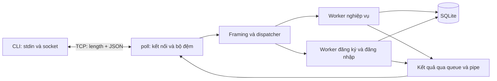

# IT4062 — Kế hoạch ứng dụng quản lý danh mục địa điểm

Cập nhật ngày 23/11/2026. Kế hoạch 4 tuần dành cho CLI client và server. Điều kiện nghiệm thu gồm **đủ chức năng**, **đủ unit test với line coverage >90%** và **một bài đo tải TCP chạy được**. Build, test và đo tải thực hiện trên Linux/WSL.

## 1. Phạm vi và tài liệu đã đọc

Repo có tài liệu môn học và code mẫu C. Đã đọc **71 tệp .c/.h** trong `1-Chap1` đến `4-Chap4` (24/11/25/11 tệp), kể cả ví dụ trong `temp/`, cùng hai Makefile bài lab. D01 có CMake, cấu hình và unit test C. D02 có server và client TCP nhận một kết nối rồi đóng. D03 bổ sung frame JSON UTF-8 và demo echo trên kết nối đó. [PROGRESS.md](PROGRESS.md) ghi các lần kiểm trên WSL. `poll()`, chức năng nghiệp vụ, migration và bài đo tải còn phải triển khai.

| Kiến thức | Giáo trình, theo số trang in | Code mẫu và ứng dụng |
|---|---|---|
| Socket TCP POSIX, byte stream, `send/recv` | §2.1–2.3, 16–17 và 23–35 | [TCP server](2-Chap2/tcp_server.c), [Lab I/O](1-Chap1/lab08_lowlevel_io.c), [Lab bộ nhớ](1-Chap1/lab10_memory.c). Dùng số byte thực và thứ tự byte mạng, giữ offset khi ghi dở. |
| Blocking, non-blocking, `select/poll/epoll` | §3.1, §3.5, 48–50, 84–85 và 97–102 | [Chat room poll](4-Chap4/chat_room_server.c) có trạng thái theo client và parser theo dòng. Mẫu gửi một lần, đồ án cần giữ phần gửi dở và bật POLLOUT. [Select client](3-Chap3/L5-IOMultiPlexing/select_client.c) minh họa ghép stdin với socket. |
| Giao thức tự định nghĩa và server push | §4.3, 113–116 | [Lab bảng lệnh](1-Chap1/lab05_function_pointer.c), [Chat server](4-Chap4/chat_server.c). Dùng bảng điều phối và cả request, response, event. |
| OpenSSL | §5.1, 118–122 | Dùng libcrypto cho KDF/token. TLS là điều kiện khi dùng Internet hoặc dữ liệu thật. |

Đã đọc mục lục (trang in 5–6) và các phần trên của [giáo trình 125 trang PDF](1-Docs/IT4062_ThuchanhLapTrinhMang_LectureNotes_1.pdf) bằng `pypdf`. Bản trong `0-Docs/` có cùng SHA-256. Số trang in ở các phần được dẫn lớn hơn số trang PDF một đơn vị.

Bản nộp lab gồm tài khoản/phiên, địa điểm thuộc năm nhóm `FOOD`, `COFFEE`, `CINEMA`, `FASHION`, `OTHER`, đồng bộ online, bạn bè, tag, inbox push và lưu bản sao có nguồn. CLI là giao diện chính. GUI, bản đồ, đổi mật khẩu, ghi offline và TLS nằm ngoài bản nộp lab. Offline chỉ đọc cache RAM còn trong cùng tiến trình. Server mặc định bind `127.0.0.1`.

## 2. Kiến trúc và cây thư mục

Linux hoặc WSL2 Ubuntu, C11 ở chế độ `gnu11` như Makefile bài lab, CMake/CTest và TCP POSIX trực tiếp. `poll()` phù hợp ví dụ môn học và quy mô 20–200 client, theo dõi cả đọc và ghi. SQLite3 đặt trên filesystem Linux cục bộ. Dùng json-c khi tới phần JSON ở D03. OpenSSL libcrypto dùng cho PBKDF2 và token. Các bài UDP, HTTP, fork và thread-per-client dùng để đối chiếu, ứng dụng dùng một tiến trình server.

D01 dựa trên ví dụ đọc `argc`/`argv`. D02 dùng lại trình tự socket của hai bài TCP và phần `getaddrinfo()`/`freeaddrinfo()` của bài phân giải tên. D03 dựa trên [bài đổi thứ tự byte](3-Chap3/bt1_tuan3.c) và cách giữ bộ đệm theo kết nối trong [chat room](4-Chap4/chat_room_server.c). D04 dùng lại vòng `poll()` của chat room và bổ sung xử lý ghi dở. Phần chức năng riêng của đồ án được viết theo yêu cầu ở những nơi bài mẫu chưa có.



Vòng `poll()` sở hữu fd, RX/TX và các phiên đã gắn. Một worker chạy nghiệp vụ và một worker chạy REGISTER/LOGIN, mỗi worker một SQLite connection và dùng chung cơ chế queue hữu hạn. KDF chạy ngoài transaction. Worker báo kết quả qua pipe non-blocking và chỉ truyền `connection_id` tăng dần, để reactor loại kết quả của kết nối đã đóng dù fd được tái sử dụng. Worker không ghi socket. SQLite, audit và KDF chạy ngoài vòng I/O. PING xử lý tại dispatcher.

| Giới hạn | Hành vi |
|---|---|
| 256 kết nối, 16 accept/lượt | Listener và socket đã accept đều non-blocking. Đọc/ghi tối đa 64 KiB mỗi kết nối mỗi lượt. |
| RX 128 KiB, TX 256 KiB/kết nối | Cấp phát theo nhu cầu. Tạm ngừng đọc ở TX 128 KiB, tiếp tục khi thấp hơn. Đóng riêng kết nối vượt trần. |
| Một request đang chạy/kết nối | Giữ frame kế tiếp trong RX. Xử lý RX còn sẵn sau khi job xong, kể cả khi chưa có POLLIN mới. |
| 256 job nghiệp vụ, 128 job xác thực | Queue đầy trả SERVER_BUSY nếu còn chỗ ghi. Queue kết quả có trần theo số job đã nhận. Reactor rút kết quả ngay khi pipe readable. |
| Deadline monotonic | Connect 5 giây. Frame hoàn thành trong 10 giây từ byte đầu. TX đứng 15 giây thì đóng. Socket chưa xác thực và chưa có job auth hết hạn sau 15 giây. Job xác thực đã nhận có ngân sách riêng 45 giây cho login burst. Poll chờ tới deadline gần nhất. |

TX giữ nguyên frame và offset, dùng chung cho response/event. Chỉ bật POLLOUT khi còn byte chờ. Đọc byte cuối khi POLLIN kèm POLLHUP. Nếu peer đóng chiều ghi sau request đầy đủ, cho phép gửi response trong deadline. SIGTERM ngừng accept, hoàn tất job đang chạy hoặc hủy job còn chờ, rồi đóng fd/DB sạch để flush coverage.

```text
CMakeLists.txt        # place_server, place_cli và CTest
src/
  transport/         # POSIX fd, poll, RX/TX, worker completion
  protocol/          # framing, envelope, dispatcher
  service/           # account, place, sync, friend, share, audit
  repository/        # SQLite và migration
  server/            # config, khởi động và dừng
  client/            # CLI, socket, demux và cache RAM
migrations/
tests/
  unit/
  tcp/               # integration, contract, CLI E2E
  load/              # một runner asyncio
```

## 3. Dữ liệu, quyền và đồng bộ

Tạo tám bảng bằng `001_init.sql`, theo version qua `PRAGMA user_version`. Migration chạy trước listen và rollback nếu lỗi. Bật foreign keys, WAL và dùng prepared statements. Transaction ghi ngắn, `SQLITE_BUSY` sau tối đa 100 ms ở worker trả `DB_BUSY`.

| Bảng | Trường và ràng buộc chính |
|---|---|
| `users` | ID, username unique, salt, hash, tham số KDF, thời điểm tạo. |
| `sessions` | ID, user ID, token hash unique, expiry, revoked_at. |
| `places` | ID, owner, name/address/category/note, version, deleted_at, source_type, source_share_id, shared_by. Unique bản sao theo owner và share. |
| `friend_requests` | ID, sender/recipient, cặp chuẩn hóa, trạng thái pending/accepted/rejected, thời điểm. Một pending cho mỗi cặp. |
| `friendships` | Khóa cặp `(user_low,user_high)`, low < high, thời điểm tạo. |
| `shares` | ID cũng là event_id, sender/recipient, source_place_id, source_version, snapshot, created_at, acked_at. Unique source/recipient, index recipient và ID. Một dòng đồng thời là một mục inbox. |
| `change_log` | Seq tự tăng, owner ID, place ID, version, op, payload hoặc tombstone. Index owner/seq. |
| `activity_log` | UTC, user ID nếu biết, request ID nếu parse được, connection ID, thao tác, mã kết quả. |

- **Phiên.** Username lowercase ASCII 3–32 ký tự, mật khẩu 8–128 byte. PBKDF2-HMAC-SHA256, salt ngẫu nhiên, tham số ban đầu 600.000 vòng. Token 32 byte ngẫu nhiên, biểu diễn hex, chỉ lưu hash ở server và token trong RAM ở CLI. TTL tuyệt đối 24 giờ. Mỗi login tạo phiên riêng, resume gắn lại phiên đang hợp lệ. Logout thu hồi đúng phiên và đóng các socket đang dùng cùng phiên sau khi trả response cho socket yêu cầu. Các phiên login khác vẫn hoạt động. Kiểm expiry/revoke trước lệnh và push. Chặn sau 5 lần xác thực sai mỗi username hoặc 20 lần sai mỗi IP trong một phút. Đếm lỗi riêng khỏi admission để queue còn phục vụ được 100 login hợp lệ cùng IP ở profile lab.
- **Owner và conflict.** User ID do session cung cấp. Place của người khác trả NOT_FOUND. UPDATE/DELETE kiểm owner và `expected_version`, tăng version trên mỗi lần ghi. DELETE lưu tombstone. Mutation place và change-log commit cùng transaction. Khi CONFLICT, CLI tải bản mới và để người dùng quyết định. Không ghi đè tự động.
- **Đồng bộ.** `SYNC.PULL` trả thay đổi địa điểm theo owner với `seq > cursor`, tăng dần. Cursor tiến theo seq lớn nhất của trang đã áp dụng. Trang rỗng giữ nguyên cursor. Lặp từng trang theo has_more, nhường lượt giữa các trang để đọc event/stdin. Kéo khi login/resume và mỗi 5 giây online. Lời mời, bạn bè và inbox đọc lại danh sách khi mở màn hình và mỗi 5 giây nếu đang xem. Log/tombstone giữ trong phạm vi học phần. Cache RAM tách theo user và bỏ khi logout/thoát. Khi mất mạng, CLI báo dữ liệu cũ và chặn ghi.
- **Bạn bè và chia sẻ.** Chặn tự mời, đã là bạn và pending trùng/chéo. Chỉ recipient quyết định lời mời pending. Accept và tạo quan hệ đối xứng chạy cùng transaction. Chỉ thành viên được hủy quan hệ. Owner chỉ được tag 1–20 bạn hiện tại, kiểm cùng version nguồn trong transaction. Một recipient sai thì cả batch rollback. Tag trùng trả share cũ sau kiểm quyền. Snapshot đã cấp vẫn xem/lưu được sau hủy bạn hoặc sửa/xóa nguồn.
- **Lưu và thử lại.** `SHARE.SAVE` chỉ cho recipient, tạo bản sao riêng với `SHARED`, `shared_by` và `source_share_id` bất biến. Save lặp trả bản sao hiện có. Nếu đã xóa bản sao thì báo GONE. CREATE dùng UUID do client sinh, thử lại cùng ID không tạo bản trùng, kể cả ID có tombstone. Mất phản hồi thì CLI báo chưa biết kết quả, tải GET/sync để xác minh trước khi người dùng thử lại. Không cần bảng idempotency tổng quát.
- **Audit.** Ghi metadata allowlist cho các lệnh tài khoản và nghiệp vụ. Audit thành công cùng transaction mutation. Lỗi nghiệp vụ ghi sau rollback. PING không tạo audit. Không ghi password/token, hash hoặc raw auth JSON. Nếu DB không ghi được log, báo lỗi vận hành đã lọc và không trả thành công cho mutation thất bại.

## 4. Giao thức v1

Frame gồm **4 byte unsigned big-endian length và 1–65.536 byte JSON UTF-8**. Length đếm byte body, chặn trước cấp phát. Parser giữ header/body thiếu và đọc được nhiều frame gộp. Dùng số byte thực của `send/recv`, thử lại EINTR trong deadline, chờ readiness khi EAGAIN/EWOULDBLOCK, dùng MSG_NOSIGNAL. EOF giữa frame, length sai hoặc UTF-8/JSON lỗi ghi nhận lỗi và đóng. Object có ID hợp lệ nhưng sai schema nhận response lỗi. Không dispatch frame dở.

Request có `v,type,request_id,command,payload`. Response lặp `request_id`, có `ok` và `data` hoặc `error`. Event có `event,event_id,data`. Reader duy nhất phân loại theo `type`. PING dùng ở mọi trạng thái, REGISTER/LOGIN/RESUME dùng khi chưa đăng nhập. Các lệnh còn lại dùng session gắn với socket. Body list/sync tối đa 60 KiB và 50 mục, mặc định 20. List dùng `after_id`, trả `items,next_cursor` (null nếu hết). Name/address/note tối đa 200/500/2.000 byte, name/address bắt buộc. ID place dùng UUID, ID user/lời mời/share là số nguyên dương. Timestamp dùng UTC RFC3339.

| ID | Lệnh | Dữ liệu chính và kết quả |
|---|---|---|
| C01 | `PING` | {} → server_time. |
| C02 | `AUTH.REGISTER` | username/password → user mới. |
| C03 | `AUTH.LOGIN` | username/password → user_id, token, expires_at. |
| C04 | `AUTH.RESUME` | token → user_id, expires_at. |
| C05 | `AUTH.LOGOUT` | {} → revoke phiên hiện tại rồi đóng socket. |
| C06 | `ACCOUNT.ME` | {} → ID, username và thời điểm tạo tài khoản. |
| C07 | `PLACE.LIST` | category?, source_type?, after_id?, limit? → trang của owner, bỏ mục đã xóa. |
| C08 | `PLACE.GET` | place_id → place của owner. |
| C09 | `PLACE.CREATE` | place_id, name, address, category, note? → place OWN version 1. |
| C10 | `PLACE.UPDATE` | place_id, expected_version, patch name/address/category/note → place mới. |
| C11 | `PLACE.DELETE` | place_id, expected_version → tombstone. |
| C12 | `SYNC.PULL` | cursor, limit? → changes, next_cursor, has_more. |
| C13 | `FRIEND.REQUEST` | username → lời mời pending. |
| C14 | `FRIEND.REQUESTS` | direction INCOMING/OUTGOING, after_id?, limit? → trang lời mời của user. |
| C15 | `FRIEND.RESPOND` | friend_request_id, decision ACCEPT/REJECT → trạng thái, chỉ recipient. |
| C16 | `FRIEND.REMOVE` | friend_user_id → removed, chỉ quan hệ của mình. |
| C17 | `FRIEND.LIST` | after_id?, limit? → trang bạn bè. |
| C18 | `SHARE.TAG` | place_id, expected_version, recipient_ids → share snapshot cho từng bạn. |
| C19 | `INBOX.LIST` | unacked_only?, after_id?, limit? → snapshot, shared_by, event_id, acked_at, chỉ recipient. |
| C20 | `INBOX.ACK` | event_id → xác nhận của recipient, gọi lặp vẫn thành công. |
| C21 | `SHARE.SAVE` | share_id → bản sao SHARED thuộc recipient. |

Mã lỗi giao thức gồm INVALID_REQUEST, VALIDATION_ERROR, UNSUPPORTED_VERSION, UNKNOWN_COMMAND. Phiên dùng AUTH_REQUIRED, INVALID_STATE, INVALID_CREDENTIALS, SESSION_EXPIRED, SESSION_REVOKED. Nghiệp vụ dùng USER_EXISTS, NOT_FOUND, GONE, ID_CONFLICT, CONFLICT, REQUEST_PENDING, ALREADY_FRIENDS, INVALID_TRANSITION, NOT_FRIENDS. Hạ tầng dùng RATE_LIMITED, SERVER_BUSY, DB_BUSY, INTERNAL_ERROR. Sai quyền với object riêng trả NOT_FOUND. CONFLICT trả `current_version` cho owner. CLI phân biệt timeout local với lỗi do server trả.

Mỗi dòng JSON dưới đây là body cho một frame riêng. Tài khoản/token chỉ để minh họa. Một phiên khác của Alice đã tăng version lên 2 trước request r3. Các frame với event 42, r4 và r5 thuộc kết nối đã đăng nhập của người nhận.

```jsonl
{"v":1,"type":"request","request_id":"r1","command":"AUTH.LOGIN","payload":{"username":"alice","password":"lab-example-password"}}
{"v":1,"type":"response","request_id":"r1","ok":true,"data":{"user_id":1,"token":"0123456789abcdef0123456789abcdef0123456789abcdef0123456789abcdef","expires_at":"2026-11-23T10:00:00Z"}}
{"v":1,"type":"request","request_id":"r2","command":"PLACE.CREATE","payload":{"place_id":"181504d0-138a-4f51-82b3-8dc8f2bf25d7","name":"Cà phê A","address":"Hà Nội","category":"COFFEE"}}
{"v":1,"type":"response","request_id":"r2","ok":true,"data":{"place":{"id":"181504d0-138a-4f51-82b3-8dc8f2bf25d7","name":"Cà phê A","address":"Hà Nội","category":"COFFEE","version":1,"source_type":"OWN"}}}
{"v":1,"type":"request","request_id":"r3","command":"PLACE.UPDATE","payload":{"place_id":"181504d0-138a-4f51-82b3-8dc8f2bf25d7","expected_version":1,"patch":{"note":"Tầng 2"}}}
{"v":1,"type":"response","request_id":"r3","ok":false,"error":{"code":"CONFLICT","message":"Địa điểm đã thay đổi","current_version":2}}
{"v":1,"type":"event","event":"TAGGED_PLACE","event_id":42,"data":{"share_id":42,"shared_by":"alice","place_name":"Cà phê A"}}
{"v":1,"type":"request","request_id":"r4","command":"INBOX.ACK","payload":{"event_id":42}}
{"v":1,"type":"response","request_id":"r4","ok":true,"data":{"event_id":42}}
{"v":1,"type":"request","request_id":"r5","command":"SHARE.SAVE","payload":{"share_id":42}}
{"v":1,"type":"response","request_id":"r5","ok":true,"data":{"place":{"id":"5c80b1de-1e28-4c48-ad2f-7575dce16af1","name":"Cà phê A","address":"Hà Nội","category":"COFFEE","version":1,"source_type":"SHARED","shared_by":"alice","source_share_id":42}}}
```

**Push tự động.** Tag commit share/inbox và audit trước khi báo reactor. LOGIN/RESUME enqueue response rồi gắn phiên và tự lấy share chưa ACK, không chờ lệnh list. Tag mới cũng kích hoạt đọc inbox cho recipient đang online. Nếu truy vấn đang chạy, giữ dấu cần đọc tiếp đến khi xử lý kết quả để không bỏ event trong race login/tag. Nếu queue đầy, giữ dấu và thử lại khi có chỗ. Mỗi socket giữ một event chưa ACK. ACK theo recipient, chỉ giải phóng slot đang chờ cùng event ID trên các socket của tài khoản. Event đã nằm trong TX có thể vẫn đến. Quá 15 giây từ khi gửi hết frame event mà chưa ACK thì đóng socket. Khi reconnect, event chưa ACK được gửi lại cùng ID. Inbox đã ACK vẫn truy vấn được. CLI lưu ID và event trong RAM theo tài khoản trước khi ACK. Trong cùng tiến trình, một event chỉ hiển thị một lần qua reconnect. Nếu CLI thoát trước ACK, event có thể hiện lại lần mở sau. ACK không tự tạo bản sao.

## 5. Ma trận rubric

Các ID trong bảng là mục tiêu nghiệm thu. [PROGRESS.md](PROGRESS.md) ghi test đã viết, đã chạy và phạm vi đã kiểm của từng task.

| ID / Tiêu chí | Điểm | Module | Dependency | Test ID và điều kiện đạt |
|---|---:|---|---|---|
| R01 Xử lý truyền dòng | 1 | Framing, transport | Socket POSIX | `TCP-01` tách/gộp, partial I/O, EOF và frame lỗi. |
| R02 I/O socket server | 2 | Poll, worker | R01 | `TCP-02` nhiều socket, slow client, timeout, thu hồi fd. |
| R03 Đăng ký/quản lý tài khoản | 2 | Account | Crypto, DB | `AUTH-01` đăng ký, trùng tên, ME và hash có salt. |
| R04 Đăng nhập/quản lý phiên | 2 | Session | R03 | `AUTH-02` login/resume/logout, expiry, hai phiên độc lập. |
| R05 Lấy danh sách địa điểm | 1 | Place | R04, DB | `PLACE-01` đúng owner, lọc danh mục và phân trang. |
| R06 Lưu địa điểm | 2 | Place, share | R04, DB | `PLACE-02` giữ sau restart, cùng ID không trùng, lưu SHARED. |
| R07 Sửa địa điểm | 1 | Place | Owner, version | `PLACE-03` hai phiên cùng version, đúng một lần sửa thành công. |
| R08 Xóa địa điểm | 1 | Place, sync | Version, DB | `PLACE-04` tombstone và cache phiên khác bỏ mục. |
| R09 Gửi lời mời kết bạn | 1 | Friend | Users, R04 | `FR-01` gửi/xem đúng chiều, chặn tự mời và trùng/chéo. |
| R10 Chấp nhận/từ chối | 1 | Friend | R09 | `FR-02` chỉ recipient quyết định, accept tạo quan hệ, reject không tạo. |
| R11 Hủy kết bạn | 1 | Friend | R10 | `FR-03` cập nhật hai phía, chặn tag mới. |
| R12 Hiển thị danh sách bạn | 1 | Friend, CLI | R10 | `FR-04` danh sách đối xứng, đúng tài khoản. |
| R13 Tag bạn bè | 2 | Share | Owner, R10, DB | `SH-01` tag nhiều bạn, rollback cả batch nếu một người sai. |
| R14 Nhận danh sách được tag | 1 | Inbox, push, CLI | R04, R13 | `SH-02` login chỉ đọc socket vẫn nhận push, ACK/reconnect và chọn lưu. |
| R15 Ghi log hoạt động | 1 | Audit | Dispatcher, DB | `LOG-01` tra request ID, có UTC/kết quả, vắng password/token. |
| **Tổng** | **20** | | | **15 tiêu chí** |

## 6. Test và coverage

| Unit ID | Module production và tình huống cần kiểm |
|---|---|
| `U-01` | Framing: header từng byte, body ở mọi offset, các frame gộp, UTF-8 split, length 0/65.536/65.537 và JSON sai. EOF dở được kiểm qua TCP thật trong `TCP-01`. |
| `U-02` | D02: thử mở, kết nối và đóng fd với TCP loopback, kiểm lỗi địa chỉ, bind, connect. D04 bổ sung EINTR/EAGAIN, offset TX, HUP cùng data, deadline và backpressure. |
| `U-03` | Dispatcher/worker: auth guard, schema, 21 lệnh, queue đầy, completion cũ, không chặn I/O và shutdown. |
| `U-04` | SQLite/repository: migration DB mới/nâng version, busy, FK, unique, rollback. Dùng SQLite thật trong DB tạm. |
| `U-05` | Account/session/crypto: verifier, salt/token, RNG lỗi, expiry, resume, revoke và validation. |
| `U-06` | Place/sync: ACL, category, CAS, tạo lại cùng ID, tombstone, cursor và page size. |
| `U-07` | Friend/share/inbox: cặp chuẩn, lời mời chéo, quyền, snapshot, ACK lặp, batch rollback và provenance. |
| `U-08` | Audit: metadata, redaction và lỗi DB. |
| `U-09` | CLI/server entrypoint: config sai, startup/shutdown, đợi stdin vẫn nhận event, cache theo user, offline, hiển thị SHARED và dedup. |

- **Integration.** Các ID mục 5 chạy trên loopback TCP thật và server subprocess dùng DB file tạm. `TCP-01/02` ép split/coalesced, gửi dở và client chậm chạy cạnh client bình thường. `ACL-01` chặn thao tác place/share/ACK của người khác. `SYNC-01` kiểm nhiều trang, hai phiên, thay đổi giữa trang và restart. `SH-02` kiểm login push trước khi gọi list, mất ACK rồi reconnect, ACK đã commit rồi restart, tag đúng lúc login, và response xen event. Chờ điều kiện có deadline.
- **Contract.** `CT-01` đọc chéo golden frame bằng mã C và codec Python độc lập. `CT-02` kiểm C01–C21 với payload đúng/sai, quyền, request ID, mã lỗi và không có side effect khi lỗi. `CT-03` kiểm event, ACK và giới hạn page.
- **E2E.** `E2E-01` chạy CLI thật qua đăng ký → CRUD → kết bạn → Bob offline được tag → login nhận push → ACK → chọn lưu SHARED. `E2E-02` chạy hai phiên cùng owner với conflict, expiry và restart.

Dùng chương trình unit test viết bằng C với `assert()` và đăng ký vào CTest. Giữ assertion hoạt động cả ở bản Release. Các ca contract và E2E có thể dùng chung bộ chạy Python với integration TCP. Test Python nhận binary từ đúng CMake build đang chạy. Đo line coverage của toàn bộ mã trong `src/`, gồm cả main, worker và CLI. Script kiểm báo cáo yêu cầu mọi tệp triển khai đều có số liệu và tỷ lệ dòng thực thi **lớn hơn 90%**. Branch coverage dùng để tham khảo. Dùng build sạch mỗi lượt và dừng subprocess sạch để flush counter.

Chạy trên Linux/WSL với GCC, CMake, Python 3, gcovr và gói phát triển `libjson-c-dev`. CTest label `w1`–`w4` ghi tuần bắt đầu có test. Đặt `RUN_ID` mới cho mỗi lần đo.

```bash
cmake -S . -B build/debug -DCMAKE_BUILD_TYPE=Debug -DBUILD_TESTING=ON
cmake --build build/debug
ctest --test-dir build/debug --output-on-failure

cmake -S . -B "build/coverage-$RUN_ID" -DCMAKE_BUILD_TYPE=Debug -DENABLE_COVERAGE=ON -DBUILD_TESTING=ON
cmake --build "build/coverage-$RUN_ID"
ctest --test-dir "build/coverage-$RUN_ID" --no-tests=error --output-on-failure
gcovr -r . "build/coverage-$RUN_ID" --filter 'src/' --no-markers --txt --print-summary --json "build/coverage-$RUN_ID/coverage.json"
python3 scripts/check_coverage_inventory.py "build/coverage-$RUN_ID/coverage.json"
```

Dùng GCC/gcov cùng version. ASan/UBSan là tùy chọn khi cần tìm lỗi bộ nhớ. Kết quả đến D03 gồm cấu hình, socket và echo theo frame. Coverage của toàn bộ chức năng và benchmark sẽ được đo sau khi triển khai.

## 7. Đo tải TCP thật

Một runner `tests/load/run.py` dùng Python `asyncio` tạo TCP client thật và ghép response theo request ID. Seed **4062** tạo 250 tài khoản, mỗi tài khoản có 30 place chia đều năm nhóm. Mỗi mức tải dùng bản sao DB sạch cùng seed. Workload 45% list, 20% get, 10% create, 10% update, 5% delete, 10% sync. Mỗi client giữ tối đa một request đang chờ, dùng ID/version hợp lệ và login trong warm-up. Các ca bạn bè, inbox và push dùng DB tạm của test chức năng.

| Profile | Kịch bản và điều kiện |
|---|---|
| `baseline` | 20 rồi 50 clients, warm-up 30 giây và đo 60 giây mỗi mức. Success >=99%, p95 <=500 ms. |
| `gate` | **100 clients**, warm-up 30 giây và đo **180 giây**. **Success >=99%, p95 <=500 ms và >=100 request thành công/s**. |
| `stress` | 200 clients, warm-up 30 giây và đo 180 giây. Không crash/mất commit, queue giữ giới hạn, phục hồi trong 30 giây khi giảm về 20 clients. |

Ba profile trên là các mức của cùng một bài đo tải. Chạy thêm soak hoặc login burst nếu cần chẩn đoán giới hạn. Giữ ca client chậm, frame dở và timeout trong `TCP-01/02` để kiểm lỗi mạng với ít kết nối.

Mọi mức tải phải giữ queue trong giới hạn, DB toàn vẹn và fd về mức ban đầu +2 trong 30 giây sau khi đóng client. Latency tính từ gửi đến khi nhận đủ response. Timeout nghiệp vụ 2 giây. Báo p50/p95/p99, tỷ lệ thành công/lỗi/timeout và request thành công mỗi giây trong cửa sổ đo. Lấy mẫu CPU, RSS và fd mỗi giây qua `/proc`. Nếu generator bão hòa thì ghi INVALID và đo lại.

```bash
cmake -S . -B build/release -DCMAKE_BUILD_TYPE=Release -DBUILD_TESTING=OFF
cmake --build build/release
for profile in baseline gate stress; do
  python3 tests/load/run.py --server build/release/place_server --seed 4062 --profile "$profile" --output "reports/load/$profile"
done
```

Lưu exact command, seed, OS/kernel, CPU/RAM/storage, toolchain, build config và Git revision. Mỗi lần chạy tạo một thư mục run ID mới bên dưới `--output`, giữ cả kết quả FAIL. Lưu request/result JSONL, tài nguyên CSV và summary JSON cùng báo cáo PASS/FAIL cho mỗi profile. Sau tối ưu, đối chiếu kết quả với lần đo trước và báo chênh lệch. Các ngưỡng là mục tiêu đặt trước, chưa có số đo.

## 8. Lộ trình 4 tuần và 28 commit dự kiến

Mỗi dòng là một deliverable có ý nghĩa và có test hoặc bằng chứng kèm theo. Owner TBD. Mỗi tuần có bảy commit dự kiến.

| Ngày / Tuần | Deliverable và kiểm chứng | Dependency | Owner | Thông điệp commit gợi ý |
|---|---|---|---|---|
| D01 / W1 | CMake cho C, CTest, kiểm config và coverage trên WSL | Linux | TBD | `build: thiết lập biên dịch và kiểm thử mã C trên Linux` |
| D02 / W1 | Socket POSIX theo bài mẫu, đóng fd bằng `close()`, U-02 | D01 | TBD | `feat: mở, kết nối và đóng socket POSIX theo bài mẫu` |
| D03 / W1 | Frame codec, U-01, TCP-01, CT-01 | D02 | TBD | `feat: đóng khung thông điệp TCP bằng độ dài và JSON` |
| D04 / W1 | Poll, RX/TX và timeout, TCP-02 | D02–03 | TBD | `feat: xử lý nhiều socket không chặn bằng poll` |
| D05 / W1 | Worker và pipe, U-03 | D04 | TBD | `feat: tách xử lý nghiệp vụ bằng worker và hàng đợi hữu hạn` |
| D06 / W1 | SQLite và migration, U-04 | D01,D05 | TBD | `feat: thêm lược đồ SQLite và giao dịch` |
| D07 / W1 | Dispatcher và CLI PING, U-03/U-09, C01 | D03–06 | TBD | `test: kiểm tra lệnh PING qua TCP thật và CLI` |
| D08 / W2 | Đăng ký, ME, audit tối thiểu, AUTH-01 | M1 | TBD | `feat: đăng ký tài khoản với mật khẩu băm kèm salt` |
| D09 / W2 | Login/resume/logout, AUTH-02 | D08 | TBD | `feat: thêm phiên có thời hạn và đăng xuất` |
| D10 / W2 | List/get, ACL, PLACE-01/ACL-01 | D09 | TBD | `feat: liệt kê và đọc địa điểm theo quyền chủ sở hữu` |
| D11 / W2 | Create với ID ổn định, PLACE-02 phần OWN | D10 | TBD | `feat: lưu địa điểm yêu thích với mã định danh ổn định` |
| D12 / W2 | CAS update/delete, PLACE-03/PLACE-04 | D11 | TBD | `feat: kiểm tra phiên bản khi sửa và ghi dấu khi xóa địa điểm` |
| D13 / W2 | Sync theo cursor, SYNC-01 | D11–12 | TBD | `feat: đồng bộ thay đổi địa điểm giữa các phiên` |
| D14 / W2 | CLI cache, conflict, restart, E2E-02 | D09–13 | TBD | `test: kiểm tra CLI sau khi kết nối lại và khi xung đột phiên bản` |
| D15 / W3 | Gửi/xem lời mời, FR-01 | M2 | TBD | `feat: gửi và xem lời mời kết bạn đang chờ` |
| D16 / W3 | Quyết định/hủy/list, FR-02/FR-03/FR-04 | D15 | TBD | `feat: quản lý quan hệ bạn bè hai chiều` |
| D17 / W3 | Tag nhiều bạn và snapshot, SH-01 | D16,D12 | TBD | `feat: lưu bản chụp địa điểm cho bạn được gắn thẻ trong một giao dịch` |
| D18 / W3 | Inbox và save, PLACE-02 phần SHARED | D17 | TBD | `feat: cho người nhận lưu bản sao địa điểm được chia sẻ` |
| D19 / W3 | Push login và ACK, SH-02, CT-03 | D09,D17–18 | TBD | `feat: đẩy thông báo và gửi lại mục chia sẻ chưa được xác nhận` |
| D20 / W3 | Audit toàn nghiệp vụ, LOG-01 | D08,D15–19 | TBD | `feat: ghi nhật ký hoạt động và ẩn thông tin xác thực` |
| D21 / W3 | CLI và full contract C01–C21, E2E-01 | D15–20 | TBD | `test: kiểm thử đầu cuối luồng kết bạn, chia sẻ và nhận thông báo` |
| D22 / W4 | Coverage toàn production, test nhánh còn thiếu | M3 | TBD | `test: bổ sung kiểm thử đường xử lý lỗi của ứng dụng` |
| D23 / W4 | Kiểm TCP với client chậm, timeout và restart | D22 | TBD | `test: kiểm tra giới hạn socket và phục hồi sau khởi động lại` |
| D24 / W4 | Runner, seed và kiểm công thức metrics | M3 | TBD | `test: thêm bài đo tải TCP có thể chạy lại bằng asyncio` |
| D25 / W4 | Baseline, phân tích và sửa bottleneck theo số đo | D23–24 | TBD | `perf: đo tải cơ sở và xử lý điểm nghẽn theo số liệu` |
| D26 / W4 | Đo 100/200 client và tổng hợp với baseline 20/50 | D25 | TBD | `test: ghi kết quả đo tải TCP và đối chiếu tiêu chí đạt` |
| D27 / W4 | Runbook kiểm từ clean checkout | D26 | TBD | `docs: hướng dẫn biên dịch, kiểm thử và nêu giới hạn bản lab` |
| D28 / W4 | Demo, ma trận bằng chứng và bàn giao | D27 | TBD | `docs: bổ sung các bước demo và bằng chứng nghiệm thu` |

| Milestone và lệnh dự kiến | PASS khi |
|---|---|
| M1 cuối W1. `ctest --test-dir build/debug -L w1 --output-on-failure` | PING qua CLI/TCP, 20 socket đồng thời, frame split/gộp và migration đúng. |
| M2 cuối W2. `ctest --test-dir build/debug -L 'w[12]' --output-on-failure` | Auth/CRUD, hai phiên có một người thắng conflict, tombstone sync và restart giữ dữ liệu. |
| M3 cuối W3. `ctest --test-dir build/debug -L 'w[123]' --output-on-failure` | 21 contract và E2E chạy, push trước lệnh list, ACK/reconnect và lưu SHARED theo lựa chọn recipient. |
| M4 cuối W4. Full CTest, coverage mục 6 và bài tải mục 7 | Đủ 15 tiêu chí, test đạt, line coverage >90%, bài tải có báo cáo thực và demo chạy từ clean checkout. |

Mỗi tuần lưu kết quả CTest và coverage cho mã đã có. Milestone FAIL nếu test lỗi, thiếu bằng chứng hoặc thiếu gate tương ứng. Nếu baseline đạt, commit D25 ghi report phân tích thay cho một thay đổi hiệu năng không cần thiết.

## 9. Bảo mật và rủi ro

Dùng bản Release để đo tải. Bản CLI/server plaintext chạy localhost hoặc lab tin cậy với tài khoản thử nghiệm. Nếu sau này chạy trên Internet, dùng TLS có xác minh chứng chỉ/hostname. Binary, DB, secret và dữ liệu đo thô lưu ngoài Git.

| Rủi ro chính | Cách giảm |
|---|---|
| Mất byte hoặc kẹt vì client chậm | TX offset, quota, deadline và TCP-01/02. |
| KDF/SQLite làm chậm xử lý | Tách worker, transaction ngắn. Đo trước khi tối ưu. |
| Mất cập nhật hoặc phát trùng khi reconnect | CAS, change-log và share commit trước push. Test nhiều phiên, lost response, ACK lặp và restart. |

## 10. Demo và bàn giao

- [ ] Clean checkout Linux build và chạy CLI/server với DB thử nghiệm. Trình bày framing bằng TCP split/gộp và nhiều client cùng kết nối.
- [ ] Hai phiên của Alice cùng sửa một place, nhận conflict đúng, đồng bộ version và tombstone. Offline đọc cache có dấu stale.
- [ ] Alice/Bob kết bạn, tag đúng quyền. Bob offline lúc tag, sau login nhận event trước lệnh list. Reconnect trước ACK nhận lại cùng ID. ACK rồi restart vẫn xem được inbox.
- [ ] Bob chủ động lưu thấy `SHARED/shared_by`. Sửa copy độc lập. Hủy bạn chặn tag mới. Tra audit theo request ID và kiểm log không lộ secret.
- [ ] Bàn giao mapping đủ 15 mục/20 điểm, báo cáo unit/contract/integration/E2E, coverage và raw load có môi trường, cùng lệnh chạy lại và giới hạn triển khai.

## 11. Phương án 3 tuần

Chỉ dùng khi có ít nhất ba người và Linux đã sẵn sàng. Tuần 1 chia transport, DB/auth và test/CLI để xong W1 và D08–09 (9 commit). Tuần 2 làm place/sync song song với friend/share/push sau khi schema và quy tắc owner ổn định (D10–19, 10 commit). Tuần 3 hoàn tất audit/E2E trước kiểm TCP, coverage, tải và bàn giao (D20–28, 9 commit). Giữ đủ 15 tiêu chí, unit test, line coverage >90% và bài đo tải. Nếu milestone trễ, dùng lịch 4 tuần.
